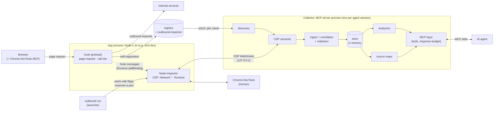
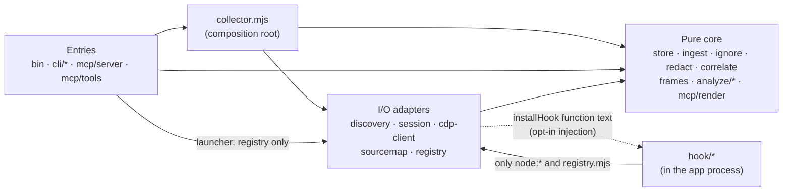
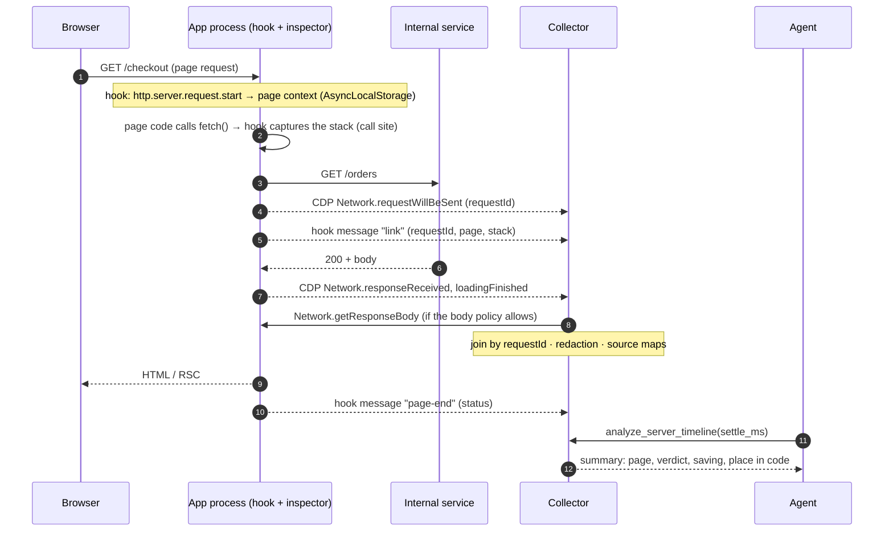

# Target architecture of `node-outbound-inspector`

_Status: proposal for acceptance · 2026-11-19 · starting point: prototype 0.3.0 (`src/outbound-mcp.mjs`) · decisions: [`docs/adr/`](adr/)_

This document describes how to turn a single-file prototype into a small, maintainable tool for a team: the module split, app discovery without fixed ports, pointing at source code, correlation with the browser, the agent contract, security, and a rollout plan in small steps.

**Evidence markers.** Every significant technical claim carries one of four markers:

| Marker | Meaning |
|---|---|
| **[Z]** | verified by experiment while writing this document: Linux container, Node 22.23.5 and 24.22.3, Bun 1.4.4, **without Next.js and without npm access**. Described in [appendix A](#appendix-a-experiments). |
| **[U]** | verified earlier by the author on macOS (Node 26.12, Next 16.4): [`test-results.md`](test-results.md). |
| **[D]** | according to external documentation: [appendix C](#appendix-c-sources). |
| **[A]** | an assumption. Each lists the milestone in which it must be checked. |

## Contents

1. [Goal, scope and principles](#1-goal-scope-and-principles)
2. [Starting point: what works and what experiments showed](#2-starting-point-what-works-and-what-experiments-showed)
3. [Architecture at a glance](#3-architecture-at-a-glance)
4. [Modules and interfaces](#4-modules-and-interfaces)
5. [Data flow](#5-data-flow)
6. [Decisions](#6-decisions)
7. [Risks](#7-risks)
8. [Rollout plan](#8-rollout-plan)
9. [Open questions](#9-open-questions)

Appendices:

- [Appendix A: experiments](#appendix-a-experiments)
- [Appendix B: a probe for real Next.js](#appendix-b-a-probe-for-real-nextjs)
- [Appendix C: sources](#appendix-c-sources)

---

## 1. Goal, scope and principles

**The goal does not change:** give developers (Chrome DevTools) and AI agents (MCP) insight into the outbound HTTP traffic of a Next.js server, which is not visible in the browser's Network tab.

**The target version additionally:**

1. works in a monorepo without port planning and without silent failures;
2. points at the file and line of app code that made the request (Next.js has nothing for this today);
3. answers the agent briefly: a summary by default, details on request;
4. does not send secrets to the model;
5. survives changes to Node's experimental flag without rewriting the tool.

**Design principles** (they settle disputes during implementation):

- **Small.** About 25 short source files, zero runtime dependencies, no build step. The split follows the seams tests need, not nouns.
- **Nothing silent.** Every "no data" state has an explicit reason in `inspector_status`: no flag, no inspector, no hook, Node < 24, port taken.
- **We touch the app process minimally and only with consent.** The code in the app process (the hook) is small, does not throw into the app and does not change its behavior.
- **A pure core, I/O at the edges.** Analyzers, store, correlation and redaction are functions without network, files or clocks.
- **Capabilities instead of versions.** The collector checks what a given process can do instead of assuming it from the Node version number.
- **The MCP tool result is public API.** Tool names, parameters and result fields change only additively.

**Out of scope:** environments other than local dev; Bun as the runtime; Edge runtime; persistent storage of traffic; distributed tracing (OpenTelemetry's job, see [`analysis.md`](analysis.md)); Next.js cache hits (no request, so no event).

---

## 2. Starting point: what works and what experiments showed

**Stays without conceptual changes:**

- the base mechanism: `--inspect` and `--experimental-network-inspection` and CDP `Network.*` events **[U, Z]**;
- several CDP clients at once (DevTools and an agent) **[U, Z]**;
- assigning a request to the page request via `http.server.request.start` and `AsyncLocalStorage` **[U, Z]**;
- the analyzer algorithm (bursts, concurrency, sequential chains, savings);
- the e2e test: 5/5 on Node 22.23.5 and 24.22.3 **[Z, E1]**.

**Prototype defects and gaps found during design.** Each has evidence and a place in the plan:

| # | Defect | Effect for the user | Evidence | Fix |
|---|---|---|---|---|
| 1 | Two MCP servers attached to the same app: the in-process correlation buffer is drained with `log.splice(0)`, so only whoever polls first gets the entries. Result: 18/18 assignments for one, 0/18 for the other. | A second agent session (e.g. a second Claude Code window or Cursor next to it) does not see pages. | **[Z, E15]** | M4 |
| 2 | `Network.enable` succeeds even when the process started **without** `--experimental-network-inspection`. The prototype then shows `network_inspection: true` and zero requests. | Silent failure number 2, next to the port conflict. | **[Z, E3]** | M2 |
| 3 | The record key is `port:requestId`, and inspector ids start again at `node-network-event-1` after a process restart. Records from before the restart are overwritten (3 instead of 6). | The "before the fix" state disappears when the agent restarts the app. | **[Z, E16]** | M2 |
| 4 | On Node 22, `Network.getResponseBody` for `fetch` returns an empty string **without an error**. | A missing body looks like an empty service response. | **[Z, E5]** | M2 |
| 5 | `analyze_server_timeline` grows linearly with the buffer: 132 requests give 88,072 characters, around Claude Code's default limit (warning from 10k tokens, limit 25k **[D]**). In-flight requests are skipped without notice. | A response truncated by the client or flooding the context. | **[Z, E23]** | M6, M2 |
| 6 | Request and response headers (`Authorization`, `Cookie`, `Set-Cookie`) reach the agent unchanged. | Integration secrets in the model context. | code, **[Z, E4]** | M2 |

---

## 3. Architecture at a glance



Four parts, each with one responsibility:

1. **Launcher** (`outbound run -- next dev`). Adds the flags that cannot be passed through `NODE_OPTIONS`, reserves a free inspector port and loudly reports when the inspector did not start. Lives as long as the app.
2. **Hook** (code in the app process, loaded with `--import`). Registers the process in the registry, remembers which page request caused a request, and captures the `fetch` call site in app code. Stores nothing: it pushes short messages to the attached collectors.
3. **Collector** (the MCP server process or a CLI command). Finds apps in the registry, attaches over CDP, assembles events into records, redacts secrets, resolves source maps, analyzes.
4. **MCP and CLI layer.** Exposes the collector to the agent (`outbound mcp`) and to people (`outbound status`, `outbound tail`).

**Two channels, one connection.** Two streams flow from the app process over the same CDP WebSocket:

- channel A, `Network.*` events: _what_ was sent and what came back. Node does this, not us.
- channel B, hook messages: _who and from where_ made the call. The hook does this.

Both are joined by the `requestId`, which the Node inspector stores on the request object **[Z, E13]**. So there is no matching by URL and time (it stays as a fallback).

### Glossary

We use these names consistently in docs, code and tool results. A "page request" always comes into the app, an "outbound request" always leaves it.

| Term | Meaning | Avoid |
|---|---|---|
| **App** | A logical app in the monorepo, recognized by package name, e.g. `@acme/web`. | "server", "port" |
| **App process** | A concrete Node process (pid) with an active inspector. An app has many over time (restarts). | "app" meaning a process |
| **Page request** | An HTTP request that came into the app and in whose context outbound requests were made: document, RSC payload, Server Action, Route Handler. | "page", "request" |
| **Outbound request** | An HTTP request made by the app process to another service. | "server request", "request" |
| **Call site** | The file and line in app code that initiated an outbound request. | "stack", "origin" in human-facing text |
| **Collector** | The process that attaches to inspectors and stores and analyzes traffic. | "server" without qualification |
| **Hook** | The tool's code running in the app process. | "agent" (reserved for the AI agent) |
| **Registry** | A directory with entries of app processes that registered themselves. | "port list" |
| **Burst** | A group of requests separated from others by a gap without traffic. | |
| **Sequential chain** | Requests where each starts right after the previous one ends (waterfall). | "cascade" |
| **Marker** | The value of a header set by the agent in the browser, used to filter traffic. | "trace id" |

---

## 4. Modules and interfaces

### Directory structure

```text
bin/
  outbound.mjs            # the only executable: outbound <mcp|run|status|tail>
src/
  outbound-mcp.mjs        # backward compatibility: same as `outbound mcp` (to remove in 1.0)
  config.mjs              # env + outbound.config.json + flags → frozen Config
  collector.mjs           # composition root: the only place with clocks and effects
  registry.mjs            # registry format, atomic writes, port reservations
  discovery.mjs           # registry + port scanning (compatibility) → targets to attach
  cdp-client.mjs          # WebSocket + CDP JSON-RPC
  session.mjs             # lifecycle of one CDP session: identity, capabilities, hook
  ingest.mjs              # CDP events and hook messages → store changes (pure)
  redact.mjs              # redaction of headers, URL parameters, JSON fields (pure)
  ignore.mjs              # skip rules at ingestion: IGNORE_HOSTS, inspectors, OTLP export (pure)
  store.mjs               # in-memory model, indexes, retention, queries (pure)
  correlate.mjs           # joining a hook message with a record: requestId, fallback URL+time (pure)
  frames.mjs              # frame classification, call site choice (pure)
  sourcemap.mjs           # generated position → source position (node:module SourceMap)
  analyze/
    timeline.mjs          # spans, bursts, concurrency (pure)
    waterfall.mjs         # sequential chains and savings (pure)
    dependencies.mjs      # data dependencies between requests: heuristic (pure)
    findings.mjs          # errors, duplicates, slow, in flight; report (pure)
  hook/
    hook.mjs              # installHook(): code running in the app process
    preload.mjs           # entry for --import: self-registration + installHook
  mcp/
    server.mjs            # JSON-RPC over stdio, both MCP protocol eras
    tools.mjs             # tool definitions: schemas + collector calls
    render.mjs            # response shape: rows, shortening, budget, cursors (pure)
  cli/
    run.mjs               # launcher
    status.mjs            # diagnostics for people
    tail.mjs              # live traffic view in the terminal
test/
  unit/                   # pure modules, on recorded events
  e2e/                    # scenarios with processes (current test + new ones)
  compat/                 # Node compatibility probes (version matrix + nightly)
  golden/                 # tool result snapshots (the agent contract)
  fixtures/               # fake-app, services, *.ndjson recordings, source maps
```

A directory exists only where files share a role and a different runtime environment: `hook/` runs in someone else's process, `mcp/` is the protocol, `cli/` are commands, `analyze/` are pure analyzers. While a file has fewer than about 150 lines, we do not split it further.

### Dependency rule



- An arrow means "imports". The core imports nothing outside the core, does not read `process.env`, does not use `Date.now()` or `setTimeout` (time comes in as an argument).
- I/O adapters do not know each other except the `session` → `cdp-client` pair; `collector.mjs` composes them.
- `hook/*` imports only `node:` modules and `registry.mjs`. `installHook` is a self-contained function, so it can be sent as text through `Runtime.evaluate`.
- Importing any module has no side effects. Clocks, sockets and `process.stdin` are started only by `collector.start()` or a CLI command.

### Modules

| Module | Responsibility | I/O | How tested |
|---|---|---|---|
| `config` | The one place reading the environment, the config file and flags. Order: flags > env > file > defaults. | env, file | unit |
| `registry` | `apps/<pid>.json` entries, atomic writes with mode 0600, cleanup of dead entries, `claims/<port>` reservations. Shared by the launcher, hook and collector. | files | unit on a temp directory |
| `discovery` | Watches the registry and, as today, scans ports (`/json/list`). Reports targets and their disappearance. | files, HTTP | e2e |
| `cdp-client` | `send()` with a timeout and rejection on error, event subscription, close. | WebSocket | unit with a fake WS server |
| `session` | Attaching to a target: identity, capability detection, `Network.enable` with buffer limits, hook attachment, cleanup. | CDP | e2e |
| `ingest` | A reducer: a CDP event or hook message plus the store give changes and a list of effects (fetch the body, resolve frames). | none | unit on recordings from Node 22, 24, 26 |
| `redact` | Redaction at ingestion. | none | unit |
| `store` | Processes, page requests, outbound requests; indexes; retention; `select()`. | none | unit |
| `correlate` | Exact join by `requestId`, fallback by method, URL and time. | none | unit |
| `frames`, `sourcemap` | Generated frame → source file and line; choosing the first app-code frame. | file reads (injected) | unit on maps from `fixtures/` |
| `analyze/*` | Today's algorithm split into functions, plus new findings: duplicates, slow, in flight. | none | unit on recordings, golden snapshots |
| `mcp/server` | Line framing, JSON-RPC, version negotiation in both protocol eras. `handle(msg)` is pure. | stdio | unit, optionally a compatibility test with the official client |
| `mcp/tools`, `mcp/render` | Tool schemas and shaping responses within the character budget. | none (`render`) | unit, golden |
| `hook/hook`, `hook/preload` | See [6.2](#62-hook-delivery-protocol-join) and [6.3](#63-source-code-call-stack-and-source-maps). | app process | in a child process: behavior compatibility, overhead |
| `cli/run` | See [6.1](#61-app-discovery-and-ports). | processes, files | e2e |
| `collector` | Composes everything: discovery → sessions → ingest → store; runs effects; exposes a facade for MCP and CLI. | all of the above | e2e |

### Interfaces (sketch)

Written in TypeScript notation for readability. The code is `.mjs` with JSDoc types.

```ts
// config.mjs
loadConfig({ env, argv, cwd }): Config

// registry.mjs: shared by the launcher, hook and collector (node:fs, node:path, node:os only)
registryDir(env): string                                   // OUTBOUND_HOME or ~/.outbound-inspector
writeEntry(dir, entry: RegistryEntry): void                // tmp + rename, mode 0600
readEntries(dir): RegistryEntry[]                          // skips broken files
pruneDead(dir): number                                     // removes entries of dead pids
claimPort(dir, appName, range): { port, release() }        // O_EXCL + free-port probe

// discovery.mjs
createDiscovery(config, { onTarget(t: Target), onGone(key) }): { start(), stop() }

// cdp-client.mjs
connectCdp(wsUrl, { timeoutMs }): Promise<Cdp>
// Cdp = { send(method, params?), on(method, fn), onClose(fn), close() }

// session.mjs
attachSession(target, { connect, config, onNetwork, onHook }): Promise<Session>
// Session = { id, app, pid, cwd, node, capabilities, warnings, fetchBody(requestId), close() }

// ingest.mjs: pure reducers, collector.mjs runs the effects
applyNetworkEvent(store, session, method, params, nowMs): Effect[]
applyHookMessage(store, session, message, nowMs): Effect[]
// Effect = { type: 'fetch-body', id } | { type: 'resolve-frames', id }

// store.mjs
createStore(limits): Store
// Store = { addProcess, addRequest, patchRequest, attachLink, endPage, setBody, setOrigin,
//           get(id), select(filter), pages(filter), clear(filter), stats() }

// correlate.mjs
matchLink(candidates: OutboundRequest[], link): OutboundRequest | null

// frames.mjs, sourcemap.mjs
pickCallSite(frames: Frame[], { roots }): { origin: Frame | null, stack: Frame[] }
createResolver({ readFile, stat, maxMaps }): { resolve(frame): Promise<Frame> }

// analyze/*
toSpans(requests, nowTs): Span[]
bursts(spans, { idleGapMs }): Span[][]
concurrency(spans): number
chains(spans, { seqGapMs }): Chain[]
dependencyGraph(requests): { edges: { from, to, evidence }[], check(members) }   // data dependencies
criticalPathMs(requests, edges): number                     // time after parallelizing while keeping dependencies
analyze(view: { requests, pages }, opts): Report           // keeps today's result shape

// mcp/*
createMcpServer({ info, instructions, tools }): { handle(msg): Promise<object | null> }
serveStdio(server, { stdin, stdout }): void
createTools(collector, config): Record<string, { description, inputSchema, run(args) }>
render(value, { maxChars }): string

// hook/hook.mjs: runs in the app process
installHook(installedBy: 'preload' | 'evaluate', options?): number   // returns the hook protocol version

// collector.mjs
createCollector(config): { start(), stop(), status(), store, settle(idleMs, timeoutMs), body(id) }
```

---

## 5. Data flow

### 5.1. App start

1. App script: `"dev:inspect": "outbound run -- next dev --port 3101"`.
2. The launcher determines the app name (`npm_package_name`, then `package.json` in the directory, then the directory name), reserves an inspector port from 9230–9249 and runs:
   `node --experimental-network-inspection --import <preload> <next/dist/bin/next> dev --port 3101 --inspect=127.0.0.1:<port>`.
3. The hook in the process that has an active inspector writes a registry entry: `pid`, `wsUrl` from `inspector.url()`, name, directory, Node version.
4. The launcher waits for an entry with its launch id. Entry present: it prints one line with the port. No entry after 15 s: it prints a warning that this app's traffic will not be visible, with the likely cause.
5. When the process ends, the launcher removes the entries and the reservation.

### 5.2. Collector attach

1. `discovery` reads the registry and scans ports, rejects entries of dead processes and processes outside the current repository.
2. `session` connects to `wsUrl`. It determines capabilities from the registry entry or with one `Runtime.evaluate` (read-only): whether the network flag is in `process.execArgv`, the Node version, whether the inspector listens on loopback only.
3. `Network.enable` with body buffer limits.
4. `Runtime.addBinding` with a name unique to this session, registered with the hook (`addSink`). If there is no hook, the collector injects it only when the configuration allows.

### 5.3. One page request



### 5.4. The agent's question

An MCP tool reads the store through `select()`, runs the analyzers, and `render()` trims the result to the character budget and adds how to narrow the query. A service response body not fetched right away is fetched on `get_server_request`.

---

## 6. Decisions

Every decision has a short ADR with alternatives. Below is a summary; subsections 6.1–6.8 expand each area and show what measurements the decision rests on.

| # | Decision | ADR |
|---|---|---|
| 1 | The traffic data source stays Node's built-in network inspection over CDP. Our own in-process code only enriches the data. | [0001](adr/0001-node-network-inspection-over-cdp.md) |
| 2 | The collector runs in the MCP server process, in memory, without a daemon and without writing to disk. | [0002](adr/0002-collector-in-mcp-server-process-no-daemon.md) |
| 3 | Apps register themselves; the `outbound run` launcher adds the flags and reserves the port. Port scanning stops being the primary mechanism. | [0003](adr/0003-registry-self-registration-and-launcher.md) |
| 4 | The hook is loaded with `--import` (explicit consent), pushes messages through `Runtime.addBinding`, and the join uses the inspector's `requestId`. | [0004](adr/0004-preload-hook-push-and-requestid-join.md) |
| 5 | The call site is captured by an outer `fetch` layer (a Proxy behind an accessor) at the moment app code calls it. | [0005](adr/0005-call-site-outer-fetch-layer.md) |
| 6 | The collector resolves source maps with the built-in `node:module` `SourceMap`. | [0006](adr/0006-source-maps-outside-app-process.md) |
| 7 | MCP layer without an SDK: tools only, a server supporting both protocol eras, clear criteria for moving to the SDK. | [0007](adr/0007-mcp-without-sdk-tools-only-two-eras.md) |
| 8 | Agent contract: five tools, a summary by default, a hard character budget, cursors. | [0008](adr/0008-agent-contract-response-budget.md) |
| 9 | Security: loopback only, instrumentation with consent, redaction at ingestion. | [0009](adr/0009-security-loopback-consent-redaction.md) |
| 10 | Browser correlation through a marker set by the agent; no trace propagation of our own. | [0010](adr/0010-browser-correlation-marker.md) |
| 11 | Compatibility with the experimental flag: capability detection and compatibility probes in CI. | [0011](adr/0011-compatibility-with-experimental-node-flag.md) |
| 12 | Code: ESM `.mjs` without a build step or dependencies; distributed as a monorepo devDependency. | [0012](adr/0012-esm-without-build-and-distribution.md) |

### 6.1. App discovery and ports

**Facts that narrow the choice:**

- `--experimental-network-inspection` cannot be passed through `NODE_OPTIONS` (exit code 9) or the Node 24 config file (`node.config.json`). It must be on the process command line **[Z, E2]**. Hence the need for a launcher or hand-written scripts.
- `child_process.fork` inherits `execArgv` by default, so a flag given to the CLI process reaches the child process **[Z, E18]**. That is probably why the README configuration works in Next 16.4 **[U]**; the mechanism in Next itself is an assumption **[A, M3]**.
- A fixed port inherited by a child process gives `address already in use`, and `inspector.url()` then returns `undefined`. Port 0 gives each process its own port **[Z, E18]**.
- `inspector.url()` gives the actual address also when the inspector was opened programmatically after start **[Z, E19]**.
- `next dev --inspect` (since 16.1) passes the value to the right Node process and attaches the inspector only where the app code runs **[D]**.

**Options considered:**

| Option | Assessment |
|---|---|
| Scanning a port range (today) | Needs port planning, 21 HTTP probes every 1.5 s, does not see why an app is missing. Stays unchanged until 1.0 as a compatibility mode for processes started by hand; the same process found two ways is recognized by `wsUrl`. |
| `--inspect=0` and reading the port from stderr | Needs stderr captured, which loses the TTY and colors. Rejected. |
| The launcher picks the port and writes the registry itself | Simple, but the launcher does not know which process in the tree has the inspector and cannot tell its own app from a foreign process on the same port. Insufficient. |
| **Process self-registration + the launcher as a thin wrapper** | Chosen. The process with the inspector knows its `inspector.url()` and registers itself; the launcher only builds the command, reserves the port and checks that the registration arrived. The prototype passed for three ways of starting the server and three apps at once **[Z, E20]**. |
| The system process list (`ps`, `lsof`) | OS-dependent, slow, fragile. Rejected. |
| Replacing `node` on `PATH` with a wrapper adding the flags | Works for any command, but instruments every Node tool in the tree. Too magical. Rejected. |
| Turbo integration | Turbo has no hook for wrapping commands. The integration is a `dev:inspect` script in every app and a `dev:inspect` task in `turbo.json` (`cache: false`, `persistent: true`). |

**Registry.** The `~/.outbound-inspector/` directory (`OUTBOUND_HOME` overrides it), mode 0700:

```jsonc
// apps/<pid>.json: written by the hook in the app process
{ "v": 1, "pid": 1093, "ppid": 1088, "launchId": "1080-1795091123", "name": "@acme/web",
  "cwd": "/repo/apps/web", "wsUrl": "ws://127.0.0.1:9231/52f4…", "node": "v24.22.3",
  "flags": { "network": true }, "hook": 1, "startedAt": "2026-11-19T12:00:00.000Z" }
// claims/<port>: written by the launcher (O_EXCL), contains the launcher pid
```

The home directory, not a temp one, because `os.homedir()` works even with a trimmed environment (turbo's strict mode filters variables), and `TMPDIR` may differ between a terminal and an MCP client started from a GUI **[A]**. By default the collector shows only processes with a directory inside the current repository (the nearest ancestor with `.git`), so two repositories or two worktrees of the same app do not mix. `inspector_status` lists processes skipped for this reason in one line, with how to show them (`OUTBOUND_ROOT`).

**Ports.** The launcher picks a port from 9230–9249: first the port derived from a hash of the app name, then the next free ones. A stable port per app lets `chrome://inspect` be configured once, and `outbound status` prints a ready DevTools address for every app (`devtoolsFrontendUrl` from `/json/list`). A reservation with an atomically created file rules out a collision of two launchers starting at the same moment (typical for `turbo dev`) **[Z, E20]**. Port 9229 stays free for a manual `--inspect`.

**End of the silent conflict.** Three safeguards:

1. the launcher reserves the port and checks that it is free before starting the app;
2. the launcher warns when no process registered;
3. `inspector_status` shows the state and the reason for every process. Today's fields stay, new ones are added:

```jsonc
{ "apps": [
    { "app": "@acme/web", "pid": 1093, "port": 9231, "node": "v24.22.3", "source": "registry",
      "network_inspection": true, "page_correlation": true, "hook": "preload v1", "bodies": "ok",
      "buffered_requests": 42 },
    { "app": "@acme/admin", "pid": 1101, "port": 9241, "node": "v22.23.5", "source": "port",
      "network_inspection": false, "page_correlation": false, "hook": "none",
      "warnings": ["No --experimental-network-inspection on the process command line. Start it with `outbound run`.",
                   "Node < 24: the fetch response body will not be available."] }],
  "skipped": "1 process outside the repository (OUTBOUND_ROOT=* shows all)",
  "buffered_requests_total": 42, "last_id": 42 }
```

**Launcher details:**

- Recognizes the command: `node …` (adds flags after `node`), a package binary from `node_modules/.bin` with a `#!/usr/bin/env node` header (runs its file via `process.execPath`), in particular `next dev` (passes the inspector port as a Next argument: `--inspect=127.0.0.1:<port>` **[A, M3]**). It does not guess other commands; it ends with a message showing the manual variant.
- The network flag and `--import` go in `execArgv`, not `NODE_OPTIONS`. Both then travel the same inheritance path and do not reach unrelated tools.
- `stdio: 'inherit'` to keep the TTY. The child's exit code and signal are reproduced. `SIGINT` from the terminal reaches the whole process group, so the launcher does not duplicate it; it forwards `SIGTERM` and `SIGHUP`.
- A process killed by a signal does not emit the `exit` event, so the launcher cleans up the entry, and the collector also rejects entries of dead pids **[Z, E20]**.
- `bun run dev:inspect` runs the launcher under Node, because Bun respects the `#!/usr/bin/env node` header; `bun --bun` forces Bun **[Z, E21]**. The launcher detects `process.versions.bun` and exits with a readable error.
- The hook is available without the launcher too: `node --experimental-network-inspection --inspect=127.0.0.1:0 --import node-outbound-inspector/register app.mjs`.

### 6.2. Hook: delivery, protocol, join

**Delivery.** By default through `--import` (the launcher or by hand). That is the developer's explicit consent and the only way for the hook to run from process start. Injection with `Runtime.evaluate` (as in the prototype) stays for processes found by port scanning, but must be enabled in the configuration (`OUTBOUND_INJECT=1`). Both modes install the same `installHook` function; both passed the same test **[Z, E17]**.

**What the hook does:**

1. `http.server.request.start`: `enterWith` of the page request context (as today).
2. `http.server.response.finish`: a `page-end` message with the status (the channel exists on Node 22 and 24 **[Z, E24]**).
3. `undici:request:create`, `http.client.request.created` and `http.client.request.start`: a `link` message.
4. An outer `fetch` layer: the call site, see [6.3](#63-source-code-call-stack-and-source-maps).

The hook does not buffer. With no collector attached it does nothing except keep the context.

**Hook protocol, version 1.** One JSON message per binding call:

```jsonc
{ "t": "link",
  "rid": "node-network-event-12",          // inspector requestId; null → fallback join
  "k": "fetch",                            // fetch | http
  "m": "GET", "u": "http://orders.internal/v1/orders?id=7", "at": 1795091124044,
  "page": { "id": "1093-7", "m": "GET", "u": "/checkout", "at": 1795091123990,
            "kind": "document", "tag": "run-42", "action": null, "trace": null },
  "stack": [["WebSequential", "/repo/apps/web/.next/dev/server/chunks/ssr/_abc._.js", 123, 45, 0]] }
                                           // [function, file, line, column, is async frame]
{ "t": "page-end", "id": "1093-7", "status": 200, "at": 1795091124473 }
```

In the process: `globalThis.__outboundInspector = { v: 1, installedBy, addSink(name), removeSink(name), stats() }`.

**Why push through `Runtime.addBinding` rather than polling.** The binding works in the Node inspector without `Runtime.enable`, only the session that created the binding gets the event, and after it disconnects the function stays as a harmless stub **[Z, E14]**. Every collector has its own binding, so defect 1 from section 2, the one-second delay and polling idle apps all go away.

**Why join by `requestId`.** The Node inspector stores the id on the request object under `Symbol(kInspectorRequestId)`. The hook's subscriber sees it in a microtask after the `create` event (for `node:http` already in the `start` event), and it equals the `requestId` in CDP events **[Z, E13]**. It is a Node internal, so: there is a compatibility probe, and `correlate.matchLink` keeps today's matching by method, URL and time as a second path.

### 6.3. Source code: call stack and source maps

**Findings from experiments:**

- The `undici:request:create` event is published synchronously inside the native `fetch` call, under 27–33 undici frames. With the default `Error.stackTraceLimit = 10` the app-code frame is never visible, even without any wrapper **[Z, E9]**.
- The initiator stack in the CDP event contains synchronous frames only. `Debugger.enable` and `Debugger.setAsyncCallStackDepth(32)` do not add a `parent` field **[Z, E8]**, matching an earlier observation **[U]**.
- After wrapping `fetch` in an async function (as Next does), the result depends on the number of microtasks between the user call and the native `fetch` call: 0 gives a synchronous frame, **exactly 1 gives no user frame at all**, 2 or more give `at async …` frames. The async frame points at the `await` expression, and in `Promise.all` all requests get the same position **[Z, E10]**. How many microtasks Next 16.4 makes is unknown **[A, M5]**.

**Options assessed:**

| Option | Experiment result | Feasibility in Next | Risks | Decision |
|---|---|---|---|---|
| A. The CDP initiator stack | Synchronous frames only **[Z, E8]** | No | none | Stays as extra information for plain Node |
| B. `new Error().stack` in the `undici:request:create` subscriber, no patching | Works after raising the frame limit; after wrapping it depends on the number of microtasks **[Z, E9, E10]** | Uncertain **[A]** | Fragile (microtask race), less precise | Fallback: used when there is no context from option D |
| C. Replacing `globalThis.fetch` before Next (innermost layer) | The same call moment as B, so the same results | As B | As B, plus a global patch | Rejected |
| **D. An outer `fetch` layer: a Proxy behind an accessor + `AsyncLocalStorage`** | Exact line and column even in the worst case; tells apart calls in `Promise.all`; a helper with `await` before `fetch` gives async frames higher up; 10–14 µs per call; 13 compatibility checks without caveats **[Z, E11, E12, E17]** | High, but unchecked on real Next **[A, M5]** | Changes the `globalThis.fetch` descriptor; assumes Next recognizes its own patch by the `__nextPatched` property **[A]**; does not cover `node:http` | **Chosen** |
| E. `Error.captureStackTrace` at the moment of the `fetch` call | This is option D's mechanism; on its own it must be called synchronously by user code | — | — | Part of D |
| F. The Debugger domain | Does not extend stacks **[Z, E8]**; the process can stop on a `debugger` statement | No | High | Rejected; the collector never enables the Debugger domain |
| G. Our own wrapper in app code (`apiFetch`) | Not tested | Certain | Needs changes and discipline in the app | Outside the tool |

**How option D works.** The hook turns `globalThis.fetch` into an accessor. A read returns a Proxy of the current function, a write (e.g. `globalThis.fetch = patched` in Next) only replaces the function underneath. App code therefore always hits our `apply` trap first, which captures the stack synchronously and runs the real call in `callAls.run({ sites })`. The `undici:request:create` subscriber reads the stack from the context, regardless of how many `await`s Next made on the way. Nested calls (Next calling the original `fetch`) see the existing context and pass through without capturing. The Proxy passes property reads through, so the `fetch.__nextPatched` check still works and the patch is not applied twice: that is the case in simulation **[Z, E11]**, and in real Next it is an assumption **[A, M5]**.

The stack is taken as raw `CallSite` objects (a temporary replacement of `Error.prepareStackTrace`), so it does not depend on what Next did to stack formatting or on `--enable-source-maps`. `util.getCallSites` does not fit, because it does not return async frames **[Z, E24]**.

**`node:http` (axios, got).** There is no outer layer. The hook captures the synchronous stack in `http.client.request.created`; this gives the app line only when a library calls `http.request` synchronously from user code (`http.get` directly: yes **[Z, E17]**; axios: probably not **[A]**). Otherwise the page request assignment remains.

**Degradation order:** the place from option D → frames from option B → the CDP initiator stack → only the page request and URL (today's state). The tool result says which path produced `origin`.

**Source maps:**

- **Where:** in the collector, not in the app process. The hook sends generated positions; the collector reads `//# sourceMappingURL=` from the end of the chunk file and the map from disk.
- **With what:** the built-in `SourceMap` class from `node:module`. It handles regular and index maps (`sections`) on Node 22 and 24 **[Z, E22]**, so no library is needed.
- **Source paths:** relative to the map file (Turbopack since Next 16.1 for server code **[D]**), `file://`, `turbopack:///[project]/…`, `webpack://…`. The result is given relative to the repository directory, e.g. `apps/web/app/seq/page.js:5`. The exact Turbopack map format of Next 16.4 must be confirmed on a real app **[A, M5]**.
- **Freshness:** resolution happens right after the message arrives, and the result is stored in the record. The map cache is keyed by path + modification time. If the chunk is newer than the request (HMR managed to rebuild it), the result gets `stale: true`.
- **Code snippet:** the call line is taken from the map's `sourcesContent` or from the source file and goes into `get_server_request` as `snippet`.
- **webpack:** in dev mode modules are in `eval` with the map in a `data:` URL, and the frame has the address `webpack-internal:///(rsc)/./app/seq/page.js`. The source file follows from the address itself, the line is approximate. Full webpack mapping is out of scope until someone needs it.

### 6.4. Correlation with the browser

What is realistic in dev mode, in increasing order of invasiveness:

| Mechanism | How it works | Deterministic | Cost and risk | Decision |
|---|---|---|---|---|
| Time and URL | The `page_contains`, `last_ms` filters (exist today) | No, but enough with one developer | None | Default |
| **A marker from the agent** | The agent sets in Chrome DevTools MCP `emulate` with `extraHttpHeaders: {"x-outbound-tag": "<id>"}` **[D]**. The hook stores the header with the page request, the tools accept a `tag` filter. | Yes, for the whole tab | The header also goes to the browser's requests to other domains (possible CORS preflight) | M7, recommended for agents |
| A response header with the page request id | The hook adds `x-outbound-page-request: <id>`; the agent reads it through `get_network_request` **[D]** | Yes, for a single request | Changes the app's responses in dev | M7, opt-in only |
| `traceparent`, `x-request-id` | Read-only, if the app already has them (e.g. `@vercel/otel`): a `trace` field in the record | Yes, when the app has OTel | None | M7, read-only |
| Our own `traceparent` propagation to services | Adding the header to outbound requests | Yes | Changes traffic to integrations | Rejected |
| `Server-Timing` with results | Headers leave before the requests end (streaming) | — | — | Rejected |
| Next's internal ids | Undocumented | Unknown **[A]** | Depends on Next internals | We do not rely on them |

The hook determines the page request kind (`document`, `rsc`, `action`, `route`) from the request headers (`rsc`, `next-action`, `next-router-prefetch`) **[A, M7]**. For a Server Action the record contains the action id, which the agent can map to a file with the `get_server_action_by_id` tool from Next DevTools MCP **[D]**.

**Division of roles between MCP servers.** Chrome DevTools MCP: the browser. Next DevTools MCP (`/_next/mcp`): routes, errors, actions, compilation. `outbound`: the server's outbound traffic with headers, bodies and analysis, for any Node app. The Next 16.4 docs also list a `get_request_insights` tool ("App Router request timelines, server requests and cache behavior"), which needs `experimental.requestInsights` **[D]**. It partly overlaps with this tool and, unlike it, sees cache behavior. It could not be checked in this environment; worth comparing on a real app before M6 (see [open questions](#9-open-questions)).

> **Update (2026-11-20):** compared in [nextjs-mcp-comparison.md](nextjs-mcp-comparison.md): `get_request_insights` sees only `fetch` in a request context, without headers or bodies; the tools complement each other.

### 6.5. Data model, retention, tool responses

**Model:**

```ts
Process         { id, app, pid, cwd, node, wsUrl, source: 'registry' | 'port',
                  connectedAt, disconnectedAt?, capabilities, warnings: string[] }

PageRequest     { id /* '<pid>-<n>' */, processId, method, url,
                  kind: 'document' | 'rsc' | 'action' | 'route' | 'other', actionId?, tag?, trace?,
                  startedAtMs, endedAtMs?, status?, requestIds: number[] }

OutboundRequest { id /* global, increasing */, processId, cdpRequestId, pageRequestId?,
                  via: 'fetch' | 'http', method, url, requestHeaders,
                  status?, statusText?, mimeType?, responseHeaders?,
                  startedAtMs, tsStart, tsResponse?, tsEnd?,
                  state: 'pending' | 'finished' | 'failed', error?,
                  body: { state: 'none' | 'available' | 'truncated' | 'unavailable' | 'evicted' | 'skipped',
                          bytes?, data?, encoding?, encodedBytes? },
                  origin?: { file, line, column, fn, snippet?, via: 'call' | 'async' | 'cdp', mapped, stale? },
                  stack?: Frame[] }
```

Changes against the prototype:

- the record key is `processId:cdpRequestId`, and the collector assigns `processId` on every attach (fixes defect 3);
- `startedAtMs` is normalized: Node gives `wallTime` in milliseconds and `timestamp` in seconds **[Z, E4]**, which matches the example in Node's docs **[D]** but not the CDP spec; a value below 10¹¹ is treated as seconds;
- `tsResponse` gives the time to first byte; `pending` requests enter the analysis as open spans and a separate finding;
- the body has an explicit state instead of an empty string (fixes defect 4), and a binary body is not decoded as UTF-8.

**Response bodies.** Facts:

- Node 24 buffers bodies in the app process **separately for every CDP session**, about 100 MB by default. `Network.enable({ maxTotalBufferSize, maxResourceBufferSize })` is honored, and one session's limit does not affect another (e.g. DevTools). Exceeding the resource limit truncates the body without a signal **[Z, E7]**.
- The request body is available only for `fetch` on Node 24 and only when `content-type` contains `charset`; otherwise `getRequestPostData` returns an error or an empty string **[Z, E6]**.

Policy:

- the collector always passes its own limits (32 MB total, 2 MB per resource by default), so a few agent sessions do not take hundreds of megabytes in the app process;
- `eager` mode (default): after `loadingFinished` it fetches the body, keeps up to 256 KB per response and 32 MB total (the oldest bodies go first, metadata stays); error responses have priority;
- `lazy` mode: fetches only on `get_server_request`; Node may have removed the body already, then the state is `evicted`;
- `off` mode: never;
- truncation is detected by comparing with `content-length`, i.e. the size on the wire (before decompression);
- a body with `content-encoding` (gzip, br, zlib and raw deflate, zstd; several encodings at once) and a textual `content-type` is decompressed, with an output limit equal to the per-response limit (decompression bomb protection: the start of the body stays, state `truncated`); an unsupported or broken encoding gives state `skipped` with raw bytes in base64 and a reason;
- request body: fetched when available, otherwise state `unavailable` with a reason.

**Retention.** A ring buffer of 5000 requests (as today), a separate byte budget for bodies, page requests disappear with their last request. Records of disconnected processes stay until evicted. No writing to disk.

**MCP tools.** The number and names stay. Every tool costs agent context (today's definitions are 2659 characters **[Z, E23]**), so new needs are served by parameters, not new tools:

| Tool | What changes |
|---|---|
| `inspector_status` | Per-process capabilities and warnings are added: flag, hook, bodies, listen address, hook version. |
| `list_server_requests` | Compact rows; new filters `page_request_id`, `tag`, `status`; the result has `next_since_id`. |
| `get_server_request` | Redacted headers; paged body (`max_body_chars`, `body_offset`); call site with a code snippet; `ttfb_ms`. |
| `analyze_server_timeline` | A **summary** by default: today's fields without `timeline`, for the 20 newest page requests. The full timeline with `page_request_id` or `detail: "full"`. The `settle_ms` parameter: wait until traffic is quiet. New fields: `verdict_code`, `in_flight`, findings (duplicates, slow, in flight). |
| `clear_server_requests` | No change. |

Summary example (illustrative values). The field names today's e2e test relies on stay:

```jsonc
{ "@acme/web": {
    "total_requests": 4, "in_flight": 0,
    "errors": [{ "id": 44, "method": "POST", "url": "http://127.0.0.1:4001/payments?…", "status": 500,
                 "page": "GET /err", "origin": "apps/web/app/err/page.js:4" }],
    "by_page_request": [
      { "page": "GET /seq", "page_request_id": "1093-7", "requests": 3, "wall_ms": 469, "max_concurrency": 1,
        "verdict": "SEQUENTIAL (waterfall) …", "verdict_code": "sequential",
        "sequential_chains": [{ "length": 3, "wall_ms": 469, "if_parallel_ms": 156, "potential_saving_ms": 313,
                                "steps": ["GET …/user (153 ms)", "GET …/orders (152 ms)", "GET …/offers (151 ms)"],
                                "origins": ["apps/web/app/seq/page.js:5", "…:6", "…:7"] }] }] },
  "hint": "Full timeline: analyze_server_timeline({ page_request_id })." }
```

**Data dependencies in chains.** A request that uses data from the previous one's response (e.g. `orderId` from `POST /orders` in `GET /orders/status?orderId=…`) cannot go into `Promise.all`. The heuristic (`analyze/dependencies.mjs`): an id-like value from A's response body (a JSON leaf or key, a text token; ≥ 8 characters with a digit, a UUID, a number of ≥ 6 digits; no dates, IP addresses, versions or padding) appears in B's path, parameter (after decoding) or header, and was not sent before A ended or contained in the page URL. Fields added additively:

- in a chain: `dependencies: [{ from_step, to_step, from_id, to_id, evidence: { value, from_path?, found_in } }]` and `dependency_check: { status: 'complete' | 'partial' | 'unavailable', reason? }`;
- in a burst and a page request: `dependencies` (only when non-empty) and `dependency_check` (when there are "A finished before B started" pairs).

`if_parallel_ms`, `potential_saving_ms` and `potential_saving_ms_if_fully_parallel` are the critical path respecting the dependencies found; without them the values are as before. A missing body (fetch on Node 22, `lazy`/`off` mode, eviction, truncation, a cost limit) or B's request body (POST/PUT/PATCH, which the model does not have) gives state `partial`/`unavailable`, not "independent". Then the saving stays optimistic, as before, with a conditional hint. `verdict_code` describes the timeline and does not change. Headers and parameters with secrets are redacted before analysis, so they give no match (e.g. a login token in `Authorization`).

**Response budget:**

- goal: up to 6000 characters in a typical result; hard limit 20,000 characters (below Claude Code's warning threshold **[D]**);
- JSON without indentation (indentation is 36% of the size today **[Z, E23]**), no empty fields;
- in lists, URL parameters shortened to 80 characters, the full URL in details;
- a truncated result always contains `truncated: true` and a hint on how to narrow the query;
- paging with a cursor over the increasing `id` (`since_id`, `limit`).

**Tools, resources or prompts.**

- **Tools:** yes, exclusively. The data is dynamic and filter-dependent, and every MCP client supports tools.
- **Resources:** no. Client support is uneven, and large bodies are handled by paging in `get_server_request`.
- **Prompts:** not in 1.0. The recommended workflow goes into the server's `instructions` field, which the spec provides as hints for the model **[D]**.

**SDK or zero dependencies.** The current MCP protocol revision (2026-07-28) is stateless: it drops `initialize`, requires a `server/discover` method and metadata in every request. A client supporting both eras probes a stdio server with `server/discover` and falls back to `initialize` on any non-modern error **[D]**. The prototype answers `-32601` then, so it still works with such clients, but will not work with a new-era-only client. Decision: we stay without an SDK, and `mcp/server.mjs` supports both eras (about 60–80 more lines). Criteria for moving to the official SDK are in [ADR 0007](adr/0007-mcp-without-sdk-tools-only-two-eras.md).

### 6.6. Security

> **Implementation status (2026-11-20):** see [ADR 0009, "Implementation" section](adr/0009-security-loopback-consent-redaction.md) and README, "Security model". The points below are the original design; consent works through `OUTBOUND_INSPECT=1` / the network flag, not `OUTBOUND_INJECT`.

- **Loopback only.** The collector connects only to `127.0.0.1`. The launcher always passes `--inspect=127.0.0.1:<port>`. If a process listens on another address (e.g. `0.0.0.0`), `inspector_status` reports it.
- **Instrumentation with consent.** The hook runs in a process only when the developer loaded it (`outbound run` or `--import`). Processes found by port scanning are only observed by default; injection needs `OUTBOUND_INJECT=1`. Emergency switch: `OUTBOUND_HOOK=0`.
- **Minimal CDP footprint.** The collector uses `Network.*`, `Runtime.evaluate` (read-only expressions) and `Runtime.addBinding`. It never enables the `Debugger` or `Runtime` domains (console events).
- **Redaction at ingestion.** Values of the `authorization`, `proxy-authorization`, `cookie`, `set-cookie`, `x-api-key` headers and of names matching the pattern (`token`, `secret`, `password`, `session`, `key`) are replaced with a description `[redacted: Bearer · 142 chars · #a1b2c3]` before they reach the store. The digest lets the agent tell whether two requests carried the same secret. The same for URL parameters and JSON fields in bodies. Off only explicitly (`OUTBOUND_REDACT=0`) and with a warning in `inspector_status`.
- **Bodies are data, not instructions.** Service responses reach the model, so they may carry injected instructions. The body is truncated, clearly marked with the `body` field, and the server's `instructions` tell the model to treat it as data. The team decides with the body mode (`eager`, `lazy`, `off`) how much integration data may leave the machine.
- **Registry.** Directory 0700, files 0600. `wsUrl` contains an id that gives full control over the process.
- **Configuration without code.** The config file is JSON; the collector does not run code from the repository.
- **MCP client configuration by path, not `npx outbound`.** A short name could resolve to a foreign package from the public registry.

### 6.7. Testability

| Level | What it checks | How |
|---|---|---|
| Unit | `analyze/*`, `ingest`, `correlate`, `redact`, `store`, `frames`, `sourcemap`, `mcp/render`, `mcp/server` | `node --test` on recordings `test/fixtures/recordings/*.ndjson` (raw CDP events and hook messages from Node 22, 24, 26 and from real Next) and on source maps from `fixtures/` |
| Golden | The agent contract: `tools/list` and tool results for a fixed recording | Snapshots in `test/golden/`; a snapshot change needs a changelog entry |
| Hook | No effect on the app (the E12 list), overhead, behavior on an error inside the hook | A child process without a collector |
| E2E | The current scenario and new ones: two collectors, app restart, a process without the flag, a launcher with three apps, a Next-like `fetch` wrapper | Processes from `test/fixtures`, without Next and without network |
| Compatibility probes | The Node assumptions the tool rests on (list in [6.8](#68-distribution-configuration-versioning-compatibility)) | `test/compat/`, version matrix and a weekly nightly run |
| Next (optional) | Page assignment and call site in real Next (Turbopack) | A separate CI job with `npm install` in `examples/nextjs-monorepo` |
| MCP protocol | Both eras, errors, unknown methods | Unit; optionally the official client as a development dependency |

Recordings are made with `scripts/record-fixture.mjs`, which writes raw CDP traffic from a running app. The same script will collect recordings from the real monorepo (after redaction).

### 6.8. Distribution, configuration, versioning, compatibility

**Distribution.** The package as a devDependency in the monorepo root, pinned to a tag (`github:<owner>/node-outbound-inspector#v0.4.0` or an internal registry). Without a build step or dependencies, installing from git is trivial, and the launcher, hook and collector are always the same version.

```jsonc
// apps/web/package.json
"dev:inspect": "outbound run -- next dev --port 3101"

// turbo.json
"dev:inspect": { "cache": false, "persistent": true }

// .mcp.json in the repository root (project scope, shared through git [D])
{ "mcpServers": { "outbound": { "command": "node",
    "args": ["node_modules/node-outbound-inspector/bin/outbound.mjs", "mcp"] } } }
```

The tool's `package.json`: `bin: { outbound, outbound-mcp, outbound-next }`, `exports: { "./register": "./src/hook/preload.mjs" }`, `engines.node >= 22`.

**Configuration.** An optional `outbound.config.json` in the repository root; everything has defaults. Today's variables (`INSPECTOR_PORTS`, `APP_NAMES`, `IGNORE_HOSTS`, `PAGE_CORRELATION`, `MAX_REQUESTS`) are honored until 1.0. One default changes: from M4 the hook is not injected into processes without the launcher unless `OUTBOUND_INJECT=1` (or an explicit `PAGE_CORRELATION=1`) enables it.

**Versioning.** SemVer; 0.x until the contract stabilizes. Public API: CLI commands and flags, tool names and parameters, result fields, the registry format (`v`), the hook protocol (`v`). The collector rejects a hook with an unknown protocol version and reports it in the status.

**Compatibility:**

| Element | Minimum | Recommended | Notes |
|---|---|---|---|
| Collector and launcher | Node 24 | Node 24+ | refuse to start on older |
| App process | Node 24 | Node 24+ | an older process is not inspected (reason in `inspector_status`); on 24 the collector installs the nodejs/node#66551 workaround |
| Next.js | 16.1 (`next dev --inspect`) **[D]** | 16.4 **[U]** | |
| Bun | package manager and scripts only **[Z, E21]** | | runtime not supported **[U]** |

**Capabilities instead of versions.** The collector recognizes every difference between Node versions by behavior and shows it in `inspector_status`:

| Capability | How detected | When missing |
|---|---|---|
| Network inspection | the flag in `process.execArgv` (not the `Network.enable` result) **[Z, E3]** | status with the reason and a fix command |
| `fetch` response body | the first response with `content-length > 0` and an empty body | `body.state: unavailable`, a hint about Node 24 |
| Request body | the `getRequestPostData` result | `unavailable` with a reason |
| Exact join | `rid` present in the hook message | join by URL and time, a warning in the status |
| Push | the `Runtime.addBinding` result | no page assignment, reason in the status (no fallback: the prototype's polling goes away in M4) |

**Compatibility probes** (`test/compat/`). Each is one of the experiments from appendix A turned into a test. A red probe on nightly is an early warning, not a release blocker:

1. the network flag still rejected in `NODE_OPTIONS` (if it stops being rejected, the launcher can be simplified);
2. the shape of `Network.*` events, the units of `timestamp` and `wallTime`, the `requestId` format;
3. `Symbol(kInspectorRequestId)` on undici and `node:http` requests;
4. `Runtime.addBinding` without `Runtime.enable`;
5. response bodies and buffer limits;
6. the `diagnostics_channel` channels used by the hook;
7. `SourceMap` with an index map;
8. undici stack depth (whether 60 frames are still enough).

The `ingest` layer is the only place that knows the shape of CDP events. If the flag disappeared, the hook could take over collecting metadata from `diagnostics_channel` (without bodies) with no changes to the store, analyzers and MCP layer.

---

## 7. Risks

| # | Risk | Likelihood | Impact | Mitigation |
|---|---|---|---|---|
| 1 | Node changes or removes experimental network inspection (the docs section has status "1.1 Active development" **[D]**) | medium | high | compatibility probes, one adapter layer, a fallback path through the hook |
| 2 | The outer `fetch` layer does not work in real Next (a different patching method, a reference to `fetch` bypassing the global) | medium | medium | the appendix B probe before M5; degradation to async frames, then to the page request; ADR 0005 to update after the result |
| 3 | The hook changes app behavior (an accessor on `fetch`, `enterWith`) | low | high | developer consent, `try/catch` around all hook code, the `OUTBOUND_HOOK=0` switch, behavior compatibility tests |
| 4 | `Symbol(kInspectorRequestId)` disappears | low | low | fallback join by URL and time, a probe |
| 5 | App process memory grows through body buffers (per CDP session) | medium | medium | explicit limits in `Network.enable`, `lazy` mode |
| 6 | Secrets or personal data from integrations reach the model provider | medium | high | redaction on by default, body modes, a team decision (question 3) |
| 7 | Instruction injection through a service response body | low | medium | truncation, data marking, `instructions` |
| 8 | MCP spec changes (a large revision in July 2026) | high | low | a server for both eras, protocol tests, criteria for moving to the SDK |
| 9 | Next provides the same itself (`experimental.requestInsights`) | low (2026-11-20) | medium | checked in the code of Next 16.4.6 and canary 16.5: `get_request_insights` sees only `fetch` in a request context, without headers, bodies, `node:http`, network errors and analysis; it complements us with cache status and route. Re-check with every minor version |
| 10 | Stale entries and reservations after processes are hard-killed | high | low | pid check on read, cleanup by the launcher |
| 11 | The Turbopack source map format differs from the assumed one or changes | medium | low | the resolver handles regular and index maps and four path schemes; on error the chunk path stays |
| 12 | Several collectors at once load the app (each fetches bodies) | low | low | limits, `lazy` mode; a daemon only when this becomes a real problem (ADR 0002) |

---

## 8. Rollout plan

Dependencies: **M1 → M2 → M3 → M4 → M5**; **M6** can start after M2, independently of M3–M5; **M7** after M4 and M6. Sizes are rough: S is up to one day, M is 2–3 days, L is about a week.

Common rule: after every step `npm test` is green on Node 22 and 24, and every change to a tool result has an entry in `CHANGELOG.md`.

### Checks on the real monorepo

These could not be checked without Next.js. Each takes a few minutes on macOS and unblocks the listed milestone:

| # | Question | How | Blocks |
|---|---|---|---|
| S1 | Does `--import` from `execArgv` reach the Next server process, and when does `inspector.url()` become available? | the probe from [appendix B](#appendix-b-a-probe-for-real-nextjs), the `execArgv` line | M3 |
| S2 | Does `next dev --inspect=127.0.0.1:<port>` accept an address with a host? | run it by hand | M3 |
| S3 | Does the outer `fetch` layer give the page frame (variant B in the probe), and does the subscriber alone see it too (variant A)? | probe, lines A and B | M5 |
| S4 | Turbopack map format: does the chunk have `sourceMappingURL`, does the map have `sections`, what are the `sources`? | `tail -c 200` of the chunk, `head -c 400` of the map | M5 |
| S5 | ~~What does `get_request_insights` with `experimental.requestInsights` return?~~ **Resolved 2026-11-20** (code of Next 16.4.6, canary 16.5): `fetch` with URL, method, status, time to headers, cache status and `requestId`/`htmlRequestId`/`route`; no headers, bodies or `node:http`. Join with our results: `next_request_id`, `next_html_request_id` | Next DevTools MCP | M6 |
| S6 | Node 26: `wallTime` units, request bodies, buffer limits | `npm test` and compatibility probes on Node 26 | M2 |

### M1. Refactor without behavior change (M)

**Goal:** the same program in the modules of section 4. No new feature, no fix.

**Steps** (each separate, each green):

1. Characterization: `test/golden/` with snapshots of `tools/list` and the five tools' results for the e2e scenario, generated from the current prototype (volatile fields normalized: id, pid, ports, times).
2. `scripts/record-fixture.mjs` and the first event recordings from `test/fixtures/fake-app.mjs` on Node 22 and 24.
3. Extracting the pure parts: `analyze/*` (algorithm unchanged), `store` (`select`), `mcp/render` (`row`). Analyzer unit tests on recordings.
4. Extracting the edges: `config`, `cdp-client`, `session`, `ingest`, `mcp/server`, `mcp/tools`.
5. `collector.mjs` as a factory; `src/outbound-mcp.mjs` stays a three-line entry point.
6. Tests for the known defects from section 2 added as `todo`, so they show in the report.

**Acceptance criteria:**

- `test/e2e.test.mjs` and `test/helpers/mcp-client.mjs` are untouched and pass 5/5 on Node 22 and 24;
- golden snapshots are identical before and after the refactor;
- environment variables, tool names, `serverInfo` and the `src/outbound-mcp.mjs` path unchanged (the README stays true);
- no module exceeds about 250 lines; importing all modules in one process leaves no open handles (a test);
- CI: matrix of Node 24 and current (originally also 22; Node 22 support withdrawn on 2026-11-19).

### M2. Core correctness and security (M)

**Goal:** fix defects 2, 3, 4 and 6 and prepare the model for the next milestones.

**Steps:**

1. A per-session record key (defect 3).
2. Detecting the flag through `process.execArgv`; `inspector_status` with reasons (defect 2).
3. Body state, binary bodies, limits in `Network.enable`, `eager`/`lazy`/`off` modes (defect 4).
4. Time normalization, `ttfb_ms`, in-flight requests in the analysis.
5. Redaction at ingestion: headers and URL parameters (defect 6).
6. MCP hygiene: version from `package.json`, a list of supported protocol versions instead of an echo, the `instructions` field.

**Acceptance criteria:**

- the M1 `todo` tests for defects 2, 3, 4 and 6 are green;
- e2e "restart": after an app restart on the same port, 6 records are visible, not 3;
- e2e "no flag": `network_inspection: false` and a reason in the status;
- e2e "secret": the value `Bearer SECRET` from the test app appears in no result of any tool;
- unit: `redact` (headers, URL, digest), `ingest` on recordings from Node 22 and 24 (including the empty `fetch` body on 22 giving `unavailable`);
- buffer limits: with the configured limit, the oldest of 40 responses of 2 MB is no longer available in Node (proof that the limit arrived), and its record has the body fetched earlier or state `evicted`;
- golden snapshots changed only additively, with a changelog entry.

### M3. Launcher, registry, self-registration (L)

**Goal:** apps in a monorepo start without specifying ports; a missing inspector is never silent.

**Steps:**

1. `registry.mjs` and `hook/preload.mjs` in a registration-only version (no hook).
2. `discovery` reads the registry; port scanning stays unchanged (default range, `INSPECTOR_PORTS`), and a process found two ways is one target.
3. `cli/run.mjs`: the `node` command, package binaries, the Next adapter, port reservation, waiting for registration, warning, signals, exit code, Bun detection. Starting point: `src/cli/launch.mjs` from issue #5 (`outbound-next`: resolving `next` from cwd, `spawn` with `process.execPath` without a shell, signals, exit code, Bun detection). `outbound-next` stays an alias of `outbound run -- next`.
4. `cli/status.mjs`; `bin/outbound.mjs`; `exports["./register"]`.
5. Updating `examples/nextjs-monorepo` and the README.

**Acceptance criteria:**

- e2e: three test apps started at once through `outbound run` without ports are visible in `inspector_status` under the right names and on different ports;
- e2e: three ways of starting the server (fork with `execArgv`, fork with `NODE_OPTIONS`, `inspector.open()` after start) register correctly;
- e2e: the preferred port taken by a foreign process → the launcher takes the next one; no registration in time → a warning on stderr and a problem entry in `outbound status`;
- e2e: after `SIGINT` the registry and reservations are empty; stale entries after `SIGKILL` are skipped by the collector;
- e2e: two copies of the same app in different directories (worktrees) get different ports, and a collector started in one directory sees only its own;
- by hand on macOS (S1, S2): `turbo run dev:inspect` with at least two Next apps; both in the status; the Chrome DevTools Network tab works on the printed ports; `bun run dev:inspect` works, `bun --bun` gives a readable error.

### M4. Hook version 1 (M)

**Goal:** fix defect 1, exact join, a page-request-end event.

**Steps:**

1. `hook/hook.mjs`: page context, `link`, `page-end`, pushing to sinks; the preload installs the hook.
2. `session`: `Runtime.addBinding`, `addSink`, protocol version; injection only when enabled.
3. `correlate`: join by `rid`, the prototype's fallback path.
4. Removing the per-second polling and `pollAll()` before every tool.
5. E2E test: the current scenario gets an explicit `OUTBOUND_INJECT=1` (a deliberate change of the default, with a changelog entry); a variant with apps started with `--import` is added.

**Acceptance criteria:**

- e2e "two collectors": both see 100% of page assignments (today 18/18 and 0/18);
- e2e: the same URL called at once by two pages is joined by `requestId` (an assertion on `cdpRequestId`, not on the URL);
- unit: `correlate` on a recording with `rid: null` gives the same assignments as the prototype;
- hook in a child process: the E12 checklist passes; an exception thrown inside the hook (injected in the test) does not change the `fetch` result;
- e2e without the hook and without injection consent: the status says `hook: none`, requests are visible without a page;
- overhead: the median `fetch` time to a local service with and without the hook is measured (reported, non-blocking).

### M5. Place in code (L)

**Goal:** `origin` points at the source file and line in Next.js too.

**Steps:**

1. Hook: an outer `fetch` layer, the stack as `CallSite`, a fallback from async frames, a synchronous stack for `node:http`.
2. `frames.mjs`: classification (app code, libraries, framework internals), call site choice.
3. `sourcemap.mjs`: reading `sourceMappingURL`, `SourceMap`, four path schemes, a cache by modification time, `stale`.
4. `get_server_request`: `origin`, `call_stack`, `snippet`; `list_server_requests`: `origin` in the row.

**Acceptance criteria:**

- unit: a regular and an index map from `fixtures/` (generated with `tsc` and joined into a chunk) give the expected files and lines; relative paths, `file://`, `turbopack:///[project]/`, `webpack://`;
- e2e with a Next-like wrapper (one `await` before the real `fetch`): three consecutive `fetch` calls give three different page lines, two `fetch` calls in `Promise.all` give two different lines;
- a CI job with real Next (Turbopack) on `examples/nextjs-monorepo`: `origin` for `/seq` ends with `app/seq/page.js:5`, `:6`, `:7`;
- when the map does not exist or is broken, the result contains the chunk path and `mapped: false`, without an error;
- **decision point (S3):** if the outer layer does not work in real Next, only the fallback (async frames) ships, and ADR 0005 gets an update with the result.

### M6. Agent ergonomics (M)
**Status (2026-11-19): done.** All acceptance criteria have tests (`test/unit/budget.test.mjs`, `test/unit/mcp-server.test.mjs`, `test/e2e/settle.test.mjs`, `test/e2e/protocol.test.mjs`, defect 5 in `test/e2e/known-defects.test.mjs`). Deviations: `list_server_requests` returns an object instead of an array (the cursor and truncation marker need room), the `tag` filter moved to M7 (needs the hook), JSON field redaction in bodies added in this milestone.

**Goal:** responses fit the budget, and the protocol is ready for new-era clients.

**Steps:**

1. `mcp/render`: compact JSON, budget, `truncated`, a hint.
2. `analyze_server_timeline`: a summary by default, `page_request_id`, `detail`, `settle_ms`; findings: duplicates, slow, in flight; `verdict_code` next to today's description.
3. `list_server_requests`: new filters, `next_since_id`. `get_server_request`: `body_offset`.
4. `mcp/server`: `server/discover`, per-request metadata, `resultType`, the unsupported-version error; `initialize` stays.

**Acceptance criteria:**

- property test: for any store content (random recordings of up to 5000 requests), every result is valid JSON no longer than the limit;
- a recording of 132 requests: the `analyze_server_timeline` summary is at most 6000 characters (88,072 today);
- paging: walking with the cursor returns every record exactly once;
- `settle_ms`: analysis called during a page with three requests of 150 ms each returns all three;
- protocol: tests of both eras (`server/discover` probe, a request with metadata, an unsupported version, `initialize`); optionally the official client;
- golden snapshots updated; the changelog describes the new defaults.

### M7. Browser and the 1.0 release (M)

**Steps:**

1. Hook: the marker header, page request kind, action id, reading `traceparent`; an optional response header.
2. Tools: a `tag` filter; `kind`, `action_id`, `trace` fields.
3. `cli/tail.mjs`.
4. Documentation: the workflow with Chrome DevTools MCP and Next DevTools MCP; installation in a monorepo; data policy.
5. Compatibility probes on a weekly nightly schedule; removing the aliases marked in the changelog.

**Acceptance criteria:**

- e2e: two parallel requests to the same page with different markers are separated by the `tag` filter;
- by hand: an agent with Chrome DevTools MCP sets a marker, opens the page and gets only that tab's traffic from `analyze_server_timeline`;
- all defects from section 2 closed; all **[A]** assumptions in this document confirmed or replaced;
- the README describes installation in five steps and a "symptom → cause → fix" table based on `inspector_status`.

---

## 9. Open questions

1. **Distribution.** A private repository and a git dependency, an internal registry, or public npm? The executable name also depends on it (`outbound` is short, but not reserved).
2. **How apps start at work.** Can app scripts get `outbound run -- next dev`, and can `.mcp.json` go into the repository? Does dev start through `turbo`, `bun run` or a custom parallel script?
3. **Data policy.** May response bodies and headers of internal integrations reach the model provider? What should the default body mode be, and which company headers should be added to redaction?
4. **MCP SDK.** Do we accept our own implementation of both protocol eras (fewer dependencies, more spec tracking), or does the team prefer the official SDK right away?
5. **`experimental.requestInsights` in Next 16.4.** Should it be assessed as a complement (cache hits) before M6? **Resolved 2026-11-20:** see [nextjs-mcp-comparison.md](nextjs-mcp-comparison.md).
6. **Result language.** ~~Verdicts are in Polish today.~~ **Resolved (0.4.0):** tool output is English, with machine codes (`verdict_code`).
7. **Scope.** Does anyone use `next dev --webpack` or `node:http` clients (axios, got) enough that a call site is needed there?
8. **Node version.** ~~Does everyone have Node ≥ 24?~~ **Resolved (2026-11-19):** Node ≥ 24 is the target. `engines >= 24`, CI on 24 and the latest; Node 22 support removed: the collector and `outbound-next` do not start on Node < 24, and an app process on Node < 24 is not inspected. Verification on 24.22.3 found Node bug nodejs/node#66551 (`res.setEncoding()` with network inspection enabled destroys the connection); the collector installs a workaround in the app process (`src/hook/node-fixes.mjs`).
9. **A view for people.** Is `outbound tail` in the terminal needed, or is Chrome DevTools enough?

---

## Appendix A: experiments

Environment: Linux container, Node 22.23.5 and 24.22.3, Bun 1.4.4. Without Next.js and without access to the npm registry, so everything about Next is a simulation or an assumption. The `fetch` wrapper simulation (E10, E11, E17) reproduces the shape known from Next's code (async patch, deduplication, tracer), but was not compared with the 16.4 code. The scripts were one-off and are not part of the repository; each should become a compatibility probe or a test in the milestone named in section 8.

| # | Question | Result (the same on 22 and 24 unless noted) | Conclusion |
|---|---|---|---|
| E1 | Does the e2e test pass on both versions? | 5/5 on 22.23.5 and 24.22.3. | There is a safety net for M1. |
| E2 | Can the network flag be given outside the command line? | `NODE_OPTIONS`: rejected, code 9. `node.config.json` (Node 24): "not allowed option". `--experimental-default-config-file` in `NODE_OPTIONS`: rejected. `--inspect=127.0.0.1:0` and `--import` in `NODE_OPTIONS`: allowed. | A launcher or hand-written scripts are necessary. |
| E3 | What does `Network.enable` return without the flag? | `{}` (success), zero events. The prototype reports `network_inspection: true`. | Detect the capability through `process.execArgv`. |
| E4 | Event shape | `timestamp` in seconds (monotonic), `wallTime` in milliseconds, `requestId` = `node-network-event-N` from 1 in every process, `loadingFinished` without a size, request headers contain `authorization` verbatim. | Time normalization, a per-session key, redaction. |
| E5 | Response body | Node 22, `fetch`: `{"body":""}` without an error. Node 24, `fetch`: complete, even when the app did not read it. `node:http`: complete on both. The `undici:request:bodyChunkSent/Received` channels exist only on 24. | An explicit body state; Node 24 recommended. |
| E6 | Request body | `getRequestPostData` works only for `fetch` on Node 24 and only with `charset` in `content-type`. Without `charset`: "Unable to serialize binary request body". `node:http`: an error or an empty string. Node 22: unavailable. | Request body as optional data. |
| E7 | Body buffer in the app process (Node 24) | Without parameters: 50 of 150 responses of 2 MB kept, i.e. about 100 MB; RSS 61 → 266 MB. With `maxTotalBufferSize`/`maxResourceBufferSize`: limits honored, the oldest bodies removed ("Request not found"), a 2 MB body cut to the 1 MB limit without a signal. Limits are per session: a session with default limits still gets full bodies. | The collector always passes limits and detects truncation. |
| E8 | CDP initiator stack | Synchronous frames only. After an `await` in the wrapper, only the wrapper frame remains. `Debugger.enable` + `setAsyncCallStackDepth(32)`: no `parent`. | The initiator stack will not solve the Next problem. |
| E9 | Stack in the `undici:request:create` subscriber, `fetch` called directly | The user frame is in the synchronous stack, under 27–33 undici frames. With the default limit of 10 frames: zero user frames. | Always raise the limit during capture. |
| E10 | The same after a Next-like wrapper (async `fetch` → tracer with `then/catch/finally` → `await` → `doOriginalFetch` → `dedupeFetch`) | 0 microtasks: a synchronous frame. 1 microtask: no user frames. 2 or more: `at async` frames, position = the `await`; in `Promise.all` shared by all requests. | The subscriber alone is fragile; an outer layer is needed. |
| E11 | An outer `fetch` layer (a Proxy behind an accessor + ALS) | With 1 microtask: exact positions, different for two `fetch` calls in `Promise.all`; a helper with `await` before `fetch`: `getUser ← async pageHelper`. The simulated Next patch applied once (`__nextPatched` visible through the Proxy). Cost of capturing a 30-frame stack: 9.8 µs (22), 13.9 µs (24). | Option D is feasible and cheap. |
| E12 | Do the accessor and Proxy break typical uses? | 13 checks without caveats: `typeof`, `instanceof Function`, `name`/`length`, stable identity, `bind`, destructuring, `fetch(Request)`, replacement by a library after us, a network error, `AbortSignal`. A visible difference: the property descriptor is an accessor. | Low risk, but real for code inspecting the descriptor. |
| E13 | Does the hook see the inspector's `requestId`? | Yes: `Symbol(kInspectorRequestId)` on the undici request object and on `ClientRequest`. At `create` it is not there yet (our subscriber runs earlier), in a microtask it is; for `http.client.request.start` immediately. Before `Network.enable` the symbol is absent. | An exact join with a read in a microtask. |
| E14 | `Runtime.addBinding` in the Node inspector | Works without `Runtime.enable`; only the session that created the binding gets the event; a call from app code (a timer) arrives; after disconnecting the function stays and does nothing. | Push instead of polling. |
| E15 | Two prototype MCP servers on one app | Server A: 18/18 requests with a page. Server B: 0/18. | Defect 1. |
| E16 | App restart on the same port (prototype) | Before: 3 records. After the restart and 3 new requests: 3 records instead of 6. | Defect 3. |
| E17 | Hook version 1 end to end | Two collectors at once: each 5/5 messages, 5/5 with `rid` equal to the CDP `requestId`, call sites for `fetch` (also in `Promise.all`) and `http.get`, all `page-end`s. The same with installation via `--import` and via `Runtime.evaluate`. | The hook design from 6.2 works. |
| E18 | Flag inheritance and ports with `fork` | `execArgv` inherited by default (the network flag passes). A fixed port in parent and child: "address already in use", `inspector.url()` = `undefined`. Port 0: each process its own port. `execArgv` replaced: the flag is lost. | Explains the README configuration; the basis of self-registration. |
| E19 | `inspector.open()` after start | With the flag on the command line: network events work. `inspector.url()` gives the actual port. | The hook must check `inspector.url()` with a delay too. |
| E20 | Launcher and self-registration (prototype) | Three apps started at once, three ways of starting the server: three entries, three different stable ports, each answers over CDP and has the flag. After `SIGINT` the entries stay (a process killed by a signal does not emit `exit`) until the launcher cleans them. | The design from 6.1 works; cleanup on the launcher and collector side. |
| E21 | Bun 1.4.4 as the script runner | `bun run` and `bunx` run a file with `#!/usr/bin/env node` under Node and set `npm_package_name`. `bun --bun run` runs it under Bun. | The launcher works with Bun as the package manager; detect `--bun`. |
| E22 | `SourceMap` from `node:module` | A `tsc` map and an index map (`sections`, `turbopack:///[project]/…` paths) give correct files and lines; `findEntry` (zero-based) and `findOrigin` (one-based) available. | Zero dependencies for source maps. |
| E23 | Prototype response size | `tools/list`: 2659 characters. 11 requests: `analyze` 7549, `list` 3058. 132 requests: `analyze` 88,072 (56,398 without indentation), `list` with limit 50: 13,966. | Defect 5; budget and summary. |
| E24 | Channels and helper APIs | `http.server.request.start`, `http.server.response.finish`, `http.client.request.created`, `http.client.request.start`, `undici:request:create` publish on both versions. `util.getCallSites` does not return async frames. | The hook's channel list; the stack through `Error.captureStackTrace`. |

---

## Appendix B: a probe for real Next.js

Save as `probe-next.mjs` in the app directory and run:

```bash
node --experimental-network-inspection --import ./probe-next.mjs \
  "$(node -p "require.resolve('next/dist/bin/next')")" dev --inspect=127.0.0.1:9231
```

After visiting a page with `fetch`, the probe prints two stacks for every request. It answers questions S1 and S3 from section 8, and incidentally S2: if Next rejects an address with a host, `--inspect=9231` is enough.

```js
import dc from 'node:diagnostics_channel';
import inspector from 'node:inspector';
import { AsyncLocalStorage } from 'node:async_hooks';

const self = import.meta.url;
const tag = `[probe pid=${process.pid}]`;
console.error(tag, 'execArgv:', process.execArgv.join(' '), '| inspector.url():', inspector.url() ?? null);
setTimeout(() => console.error(tag, 'after 5 s inspector.url():', inspector.url() ?? null), 5000).unref();

const als = new AsyncLocalStorage();
const sites = () => {
  const limit = Error.stackTraceLimit, prepare = Error.prepareStackTrace;
  Error.stackTraceLimit = 60;
  Error.prepareStackTrace = (_, callSites) => callSites;
  try {
    const holder = {};
    Error.captureStackTrace(holder);
    return holder.stack
      .filter(s => s.getFileName() && s.getFileName() !== self)
      .map(s => `${s.isAsync() ? 'async ' : ''}${s.getFunctionName() ?? '(anon)'} ${s.getFileName()}:${s.getLineNumber()}:${s.getColumnNumber()}`)
      .filter(s => !/node:|node_modules/.test(s));
  } finally { Error.prepareStackTrace = prepare; Error.stackTraceLimit = limit; }
};

const proxies = new WeakMap();
const wrap = fn => {
  if (typeof fn !== 'function') return fn;
  let proxy = proxies.get(fn);
  if (!proxy) {
    proxy = new Proxy(fn, {
      apply: (target, self, args) => als.getStore()
        ? Reflect.apply(target, self, args)
        : als.run({ outer: sites() }, () => Reflect.apply(target, self, args)),
    });
    proxies.set(fn, proxy); proxies.set(proxy, proxy);
  }
  return proxy;
};
let current = globalThis.fetch;
Object.defineProperty(globalThis, 'fetch', {
  configurable: true, enumerable: true,
  get: () => wrap(current),
  set: v => { current = v; console.error(tag, 'globalThis.fetch replaced by:', v?.name, '| __nextPatched =', v?.__nextPatched); },
});

dc.subscribe('undici:request:create', ({ request }) => {
  console.error(tag, request.method, request.origin + request.path,
    '\n   A) stack in the subscriber (sync + async):', sites().slice(0, 4).join(' <- ') || '(no app frames)',
    '\n   B) stack from the outer fetch layer      :', als.getStore()?.outer.slice(0, 4).join(' <- ') || '(none: fetch did not pass through the layer)');
});
```

How to read the result:

- the `execArgv` line appears once for every Node process in the tree. The process where `inspector.url()` is not `null` is the server process (S1);
- variant B with a page file frame (a chunk in `.next/dev/server/chunks/ssr/`): option D works;
- variant A with an `async` page frame: Next makes at least two microtasks, and the fallback works too;
- no variant B: app code does not reach `fetch` through the global, or something replaces the descriptor. Then the ADR 0005 decision needs revision.

The probe shows chunk paths, not source files. That is expected: the collector does the mapping.

---

## Appendix C: sources

- Next.js 16.1, "Easier debugging with `next dev --inspect`" and "Relative source map paths": <https://nextjs.org/blog/next-16-1>
- Next.js, debugging server code (`--inspect`, the value passed to the Node process): <https://nextjs.org/docs/app/guides/debugging>
- Next.js, MCP server (`/_next/mcp`, `next-devtools-mcp`, tool list including `get_request_insights`): <https://nextjs.org/docs/app/guides/mcp>; the version shipped with the 16.4.0 package: <https://unpkg.com/next@16.4.0/dist/docs/01-app/02-guides/mcp.md>
- Node.js 26, the `inspector` module (`Network.*` methods, stability 1.1, `inspector.open()`, `inspector.url()`): <https://nodejs.org/download/release/v26.13.0/docs/api/inspector.html>
- Chrome DevTools MCP, tool reference (`list_network_requests`, `get_network_request`, `emulate` with `extraHttpHeaders`): <https://github.com/ChromeDevTools/chrome-devtools-mcp/blob/main/docs/tool-reference.md>
- MCP, changes in the 2026-07-28 revision: <https://modelcontextprotocol.io/specification/2026-07-28/changelog>
- MCP, versioning and compatibility between protocol eras: <https://modelcontextprotocol.io/specification/2026-07-28/basic/versioning.md>
- MCP, the stdio transport and the `server/discover` probe: <https://modelcontextprotocol.io/specification/2026-07-28/basic/transports/stdio.md>, <https://modelcontextprotocol.io/specification/2026-07-28/server/discover.md>
- MCP, TypeScript SDK v2 packages: <https://ts.sdk.modelcontextprotocol.io/v2/get-started/packages.html>
- Claude Code, MCP (tool result limits, `.mcp.json` in project scope): <https://code.claude.com/docs/en/mcp>
- Next.js, `logging.fetches` (logging `fetch` in dev mode): <https://nextjs.org/docs/app/api-reference/config/next-config-js/logging>
