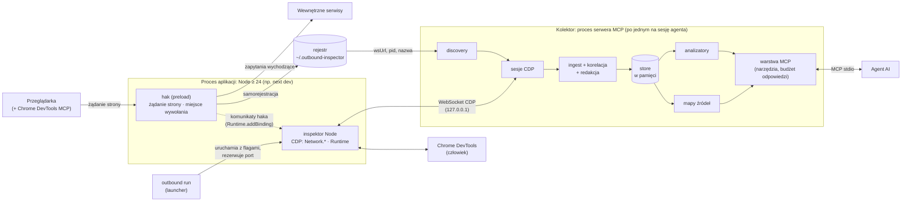
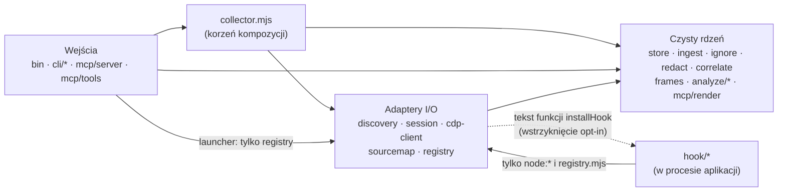
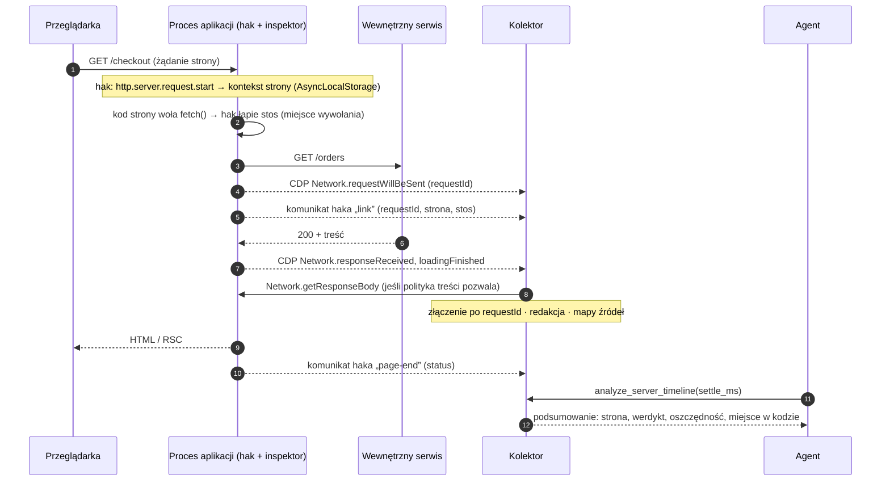

# Architektura docelowa `node-outbound-inspector`

_Status: propozycja do akceptacji · 2026-11-19 · punkt wyjścia: prototyp 0.3.0 (`src/outbound-mcp.mjs`) · decyzje: [`docs/adr/`](adr/)_

Dokument opisuje, jak z jednoplikowego prototypu zrobić małe, utrzymywalne narzędzie dla zespołu: podział na moduły, wykrywanie aplikacji bez sztywnych portów, wskazywanie kodu źródłowego, korelację z przeglądarką, kontrakt dla agentów, bezpieczeństwo i plan wdrożenia małymi krokami.

**Oznaczenia dowodów.** Każde istotne twierdzenie techniczne ma jedno z czterech oznaczeń:

| Znak | Znaczenie |
|---|---|
| **[Z]** | zweryfikowane eksperymentem przy pisaniu tego dokumentu: kontener Linux, Node 22.23.5 i 24.22.3, Bun 1.4.4, **bez Next.js i bez dostępu do npm**. Opis w [załączniku A](#załącznik-a-eksperymenty). |
| **[U]** | zweryfikowane wcześniej przez autora na macOS (Node 26.12, Next 16.4): [`test-results.md`](test-results.md). |
| **[D]** | wg dokumentacji zewnętrznej: [załącznik C](#załącznik-c-źródła). |
| **[A]** | założenie. Przy każdym podany jest kamień milowy, w którym trzeba je sprawdzić. |

## Spis treści

1. [Cel, zakres i zasady](#1-cel-zakres-i-zasady)
2. [Punkt wyjścia: co działa, a co wyszło w eksperymentach](#2-punkt-wyjścia-co-działa-a-co-wyszło-w-eksperymentach)
3. [Architektura w skrócie](#3-architektura-w-skrócie)
4. [Moduły i interfejsy](#4-moduły-i-interfejsy)
5. [Przepływ danych](#5-przepływ-danych)
6. [Decyzje](#6-decyzje)
7. [Ryzyka](#7-ryzyka)
8. [Plan wdrożenia](#8-plan-wdrożenia)
9. [Otwarte pytania](#9-otwarte-pytania)

Załączniki:

- [Załącznik A: eksperymenty](#załącznik-a-eksperymenty)
- [Załącznik B: sonda dla prawdziwego Next.js](#załącznik-b-sonda-dla-prawdziwego-nextjs)
- [Załącznik C: źródła](#załącznik-c-źródła)

---

## 1. Cel, zakres i zasady

**Cel się nie zmienia:** dać deweloperom (Chrome DevTools) i agentom AI (MCP) wgląd w wychodzący ruch HTTP serwera Next.js, którego nie widać w zakładce Network przeglądarki.

**Wersja docelowa ma dodatkowo:**

1. działać w monorepo bez planowania portów i bez cichych awarii;
2. wskazywać plik i linię kodu aplikacji, która wykonała zapytanie (dziś w Next.js tego nie ma);
3. odpowiadać agentowi krótko: domyślnie podsumowanie, szczegóły na żądanie;
4. nie wysyłać sekretów do modelu;
5. przetrwać zmiany eksperymentalnej flagi Node bez przepisywania narzędzia.

**Zasady projektowe** (rozstrzygają spory przy implementacji):

- **Małe.** Około 25 krótkich plików źródłowych, zero zależności uruchomieniowych, bez kroku budowania. Podział idzie po szwach potrzebnych testom, nie po rzeczownikach.
- **Nic po cichu.** Każdy stan „brak danych” ma jawny powód w `inspector_status`: brak flagi, brak inspektora, brak haka, Node < 24, port zajęty.
- **Proces aplikacji dotykamy minimalnie i tylko za zgodą.** Kod w procesie aplikacji (hak) jest mały, nie rzuca wyjątków do aplikacji i nie zmienia jej zachowania.
- **Czysty rdzeń, I/O na krawędziach.** Analizatory, magazyn, korelacja i redakcja to funkcje bez sieci, plików i zegarów.
- **Możliwości zamiast wersji.** Kolektor sprawdza, co dany proces potrafi, zamiast zakładać to z numeru wersji Node.
- **Wynik narzędzia MCP to publiczne API.** Nazwy narzędzi, parametry i pola wyniku zmieniamy tylko addytywnie.

**Poza zakresem:** środowiska inne niż lokalny dev; Bun jako runtime; Edge runtime; trwałe przechowywanie ruchu; tracing rozproszony (to zadanie OpenTelemetry, patrz [`analysis.md`](analysis.md)); trafienia w cache Next.js (nie ma zapytania, więc nie ma zdarzenia).

---

## 2. Punkt wyjścia: co działa, a co wyszło w eksperymentach

**Zostaje bez zmian koncepcyjnych:**

- mechanizm bazowy: `--inspect` i `--experimental-network-inspection` oraz zdarzenia CDP `Network.*` **[U, Z]**;
- kilka klientów CDP naraz (DevTools i agent) **[U, Z]**;
- przypisanie zapytania do żądania strony przez `http.server.request.start` i `AsyncLocalStorage` **[U, Z]**;
- algorytm analizatora (serie, współbieżność, łańcuchy sekwencyjne, oszczędność);
- test e2e: 5/5 na Node 22.23.5 i 24.22.3 **[Z, E1]**.

**Wady i luki prototypu znalezione przy projektowaniu.** Każda ma dowód i miejsce w planie:

| # | Wada | Skutek dla użytkownika | Dowód | Naprawa |
|---|---|---|---|---|
| 1 | Dwa serwery MCP podłączone do tej samej aplikacji: bufor korelacji w procesie jest opróżniany przez `log.splice(0)`, więc wpisy dostaje tylko ten, kto odpyta pierwszy. Wynik: 18/18 przypisań u jednego, 0/18 u drugiego. | Druga sesja agenta (np. drugie okno Claude Code albo Cursor obok) nie widzi stron. | **[Z, E15]** | M4 |
| 2 | `Network.enable` zwraca sukces także wtedy, gdy proces wystartował **bez** `--experimental-network-inspection`. Prototyp pokazuje wtedy `network_inspection: true` i zero zapytań. | Cicha awaria numer 2, obok konfliktu portów. | **[Z, E3]** | M2 |
| 3 | Klucz rekordu to `port:requestId`, a identyfikatory inspektora po restarcie procesu zaczynają się znów od `node-network-event-1`. Rekordy sprzed restartu są nadpisywane (3 zamiast 6). | Znika stan „przed poprawką”, gdy agent restartuje aplikację. | **[Z, E16]** | M2 |
| 4 | Na Node 22 `Network.getResponseBody` dla `fetch` zwraca pusty łańcuch **bez błędu**. | Brak treści wygląda jak pusta odpowiedź serwisu. | **[Z, E5]** | M2 |
| 5 | `analyze_server_timeline` rośnie liniowo z buforem: 132 zapytania dają 88 072 znaki, czyli okolice domyślnego limitu Claude Code (ostrzeżenie od 10 tys. tokenów, limit 25 tys. **[D]**). Zapytania w toku są pomijane bez informacji. | Odpowiedź obcinana przez klienta albo zapychająca kontekst. | **[Z, E23]** | M6, M2 |
| 6 | Nagłówki żądań i odpowiedzi (`Authorization`, `Cookie`, `Set-Cookie`) trafiają do agenta bez zmian. | Sekrety integracji w kontekście modelu. | kod, **[Z, E4]** | M2 |

---

## 3. Architektura w skrócie



Cztery części, każda z jedną odpowiedzialnością:

1. **Launcher** (`outbound run -- next dev`). Dokłada flagi, których nie da się podać przez `NODE_OPTIONS`, rezerwuje wolny port inspektora i głośno zgłasza, gdy inspektor nie wystartował. Żyje tak długo jak aplikacja.
2. **Hak** (kod w procesie aplikacji, ładowany przez `--import`). Rejestruje proces w rejestrze, pamięta, które żądanie strony wywołało zapytanie, i łapie miejsce wywołania `fetch` w kodzie aplikacji. Niczego nie przechowuje: wypycha krótkie komunikaty do podłączonych kolektorów.
3. **Kolektor** (proces serwera MCP albo polecenie CLI). Znajduje aplikacje w rejestrze, podłącza się po CDP, składa zdarzenia w rekordy, redaguje sekrety, rozwiązuje mapy źródeł, analizuje.
4. **Warstwa MCP i CLI.** Wystawia kolektor agentowi (`outbound mcp`) i człowiekowi (`outbound status`, `outbound tail`).

**Dwa kanały, jedno połączenie.** Z procesu aplikacji płyną dwa strumienie po tym samym WebSockecie CDP:

- kanał A, zdarzenia `Network.*`: _co_ zostało wysłane i co wróciło. To robi Node, nie my.
- kanał B, komunikaty haka: _kto i skąd_ to wywołał. To robi hak.

Oba łączy identyfikator `requestId`, który inspektor Node zapisuje na obiekcie żądania **[Z, E13]**. Dzięki temu nie ma dopasowywania po URL i czasie (zostaje jako ścieżka awaryjna).

### Słownik pojęć

W dokumentacji, kodzie i wynikach narzędzi używamy tych nazw konsekwentnie. „Żądanie” zawsze przychodzi do aplikacji, „zapytanie” zawsze z niej wychodzi.

| Pojęcie | Znaczenie | Unikać |
|---|---|---|
| **Aplikacja** | Logiczna aplikacja z monorepo, rozpoznawana po nazwie pakietu, np. `@acme/web`. | „serwer”, „port” |
| **Proces aplikacji** | Konkretny proces Node (pid) z aktywnym inspektorem. Aplikacja ma ich w czasie wiele (restarty). | „aplikacja” w znaczeniu procesu |
| **Żądanie strony** | Żądanie HTTP, które przyszło do aplikacji i w którego kontekście powstały zapytania wychodzące: dokument, ładunek RSC, Server Action, Route Handler. | „strona”, „request” |
| **Zapytanie wychodzące** | Zapytanie HTTP wykonane przez proces aplikacji do innego serwisu. | „zapytanie serwera”, „request” |
| **Miejsce wywołania** | Plik i linia w kodzie aplikacji, które zainicjowały zapytanie wychodzące. | „stos”, „origin” w tekście dla ludzi |
| **Kolektor** | Proces, który podłącza się do inspektorów, przechowuje i analizuje ruch. | „serwer” bez dopowiedzenia |
| **Hak** | Kod narzędzia działający w procesie aplikacji. | „agent” (zarezerwowane dla agenta AI) |
| **Rejestr** | Katalog z wpisami procesów aplikacji, które same się zgłosiły. | „lista portów” |
| **Seria** | Grupa zapytań oddzielona od innych przerwą bez ruchu. | „burst” w tekście dla ludzi |
| **Łańcuch sekwencyjny** | Zapytania, z których każde startuje tuż po zakończeniu poprzedniego (waterfall). | „kaskada” |
| **Znacznik** | Wartość nagłówka ustawionego przez agenta w przeglądarce, po której filtruje się ruch. | „trace id” |

---

## 4. Moduły i interfejsy

### Struktura katalogów

```text
bin/
  outbound.mjs            # jedyny plik wykonywalny: outbound <mcp|run|status|tail>
src/
  outbound-mcp.mjs        # zgodność wstecz: to samo co `outbound mcp` (do usunięcia w 1.0)
  config.mjs              # env + outbound.config.json + flagi → zamrożony Config
  collector.mjs           # korzeń kompozycji: jedyne miejsce z zegarami i efektami
  registry.mjs            # format rejestru, zapis atomowy, rezerwacje portów
  discovery.mjs           # rejestr + skanowanie portów (zgodność) → cele do podłączenia
  cdp-client.mjs          # WebSocket + JSON-RPC protokołu CDP
  session.mjs             # cykl życia jednej sesji CDP: identyfikacja, możliwości, hak
  ingest.mjs              # zdarzenia CDP i komunikaty haka → zmiany w magazynie (czyste)
  redact.mjs              # redakcja nagłówków, parametrów URL, pól JSON (czyste)
  ignore.mjs              # reguły pomijania przy przyjęciu: IGNORE_HOSTS, inspektory, eksport OTLP (czyste)
  store.mjs               # model w pamięci, indeksy, retencja, zapytania (czyste)
  correlate.mjs           # złączenie komunikatu haka z rekordem: requestId, awaryjnie URL+czas (czyste)
  frames.mjs              # klasyfikacja ramek, wybór miejsca wywołania (czyste)
  sourcemap.mjs           # pozycja wygenerowana → źródłowa (node:module SourceMap)
  analyze/
    timeline.mjs          # spany, serie, współbieżność (czyste)
    waterfall.mjs         # łańcuchy sekwencyjne i oszczędność (czyste)
    dependencies.mjs      # zależności danych między zapytaniami: heurystyka (czyste)
    findings.mjs          # błędy, duplikaty, wolne, w toku; raport (czyste)
  hook/
    hook.mjs              # installHook(): kod działający w procesie aplikacji
    preload.mjs           # wejście dla --import: samorejestracja + installHook
  mcp/
    server.mjs            # JSON-RPC po stdio, obie ery protokołu MCP
    tools.mjs             # definicje narzędzi: schematy + wywołania kolektora
    render.mjs            # kształt odpowiedzi: wiersze, skróty, budżet, kursory (czyste)
  cli/
    run.mjs               # launcher
    status.mjs            # diagnostyka dla człowieka
    tail.mjs              # podgląd ruchu na żywo w terminalu
test/
  unit/                   # moduły czyste, na nagranych zdarzeniach
  e2e/                    # scenariusze z procesami (obecny test + nowe)
  compat/                 # sondy zgodności z Node (macierz wersji + nightly)
  golden/                 # zrzuty wyników narzędzi (kontrakt dla agenta)
  fixtures/               # fake-app, services, nagrania *.ndjson, mapy źródeł
```

Katalog powstaje tylko tam, gdzie pliki mają wspólną rolę i inne środowisko uruchomienia: `hook/` działa w cudzym procesie, `mcp/` to protokół, `cli/` to polecenia, `analyze/` to czyste analizatory. Dopóki plik ma mniej niż około 150 linii, nie dzielimy go dalej.

### Reguła zależności



- Strzałka oznacza „importuje”. Rdzeń nie importuje niczego spoza rdzenia, nie czyta `process.env`, nie używa `Date.now()` ani `setTimeout` (czas przychodzi jako argument).
- Adaptery I/O nie znają się nawzajem poza parą `session` → `cdp-client`; składa je `collector.mjs`.
- `hook/*` importuje wyłącznie moduły `node:` i `registry.mjs`. `installHook` jest samowystarczalną funkcją, żeby dało się ją wysłać jako tekst przez `Runtime.evaluate`.
- Import dowolnego modułu nie ma efektów ubocznych. Zegary, gniazda i `process.stdin` uruchamia dopiero `collector.start()` albo polecenie CLI.

### Moduły

| Moduł | Odpowiedzialność | I/O | Jak testowany |
|---|---|---|---|
| `config` | Jedno miejsce czytające środowisko, plik konfiguracyjny i flagi. Kolejność: flagi > env > plik > domyślne. | env, plik | jednostkowo |
| `registry` | Wpisy `apps/<pid>.json`, zapis atomowy z prawami 0600, sprzątanie martwych wpisów, rezerwacje `claims/<port>`. Wspólny dla launchera, haka i kolektora. | pliki | jednostkowo na katalogu tymczasowym |
| `discovery` | Obserwuje rejestr i, jak dziś, skanuje porty (`/json/list`). Zgłasza cele i ich znikanie. | pliki, HTTP | e2e |
| `cdp-client` | `send()` z limitem czasu i odrzuceniem przy błędzie, subskrypcja zdarzeń, zamknięcie. | WebSocket | jednostkowo z fałszywym serwerem WS |
| `session` | Podłączenie do celu: tożsamość, wykrycie możliwości, `Network.enable` z limitami bufora, podpięcie haka, sprzątanie. | CDP | e2e |
| `ingest` | Reduktor: zdarzenie CDP albo komunikat haka plus magazyn dają zmiany i listę efektów (pobierz treść, rozwiąż ramki). | brak | jednostkowo na nagraniach z Node 22, 24, 26 |
| `redact` | Redakcja przy przyjęciu danych. | brak | jednostkowo |
| `store` | Procesy, żądania stron, zapytania wychodzące; indeksy; retencja; `select()`. | brak | jednostkowo |
| `correlate` | Złączenie dokładne po `requestId`, awaryjne po metodzie, URL i czasie. | brak | jednostkowo |
| `frames`, `sourcemap` | Ramka wygenerowana → plik źródłowy i linia; wybór pierwszej ramki kodu aplikacji. | odczyt plików (wstrzykiwany) | jednostkowo na mapach z `fixtures/` |
| `analyze/*` | Dzisiejszy algorytm rozbity na funkcje, plus nowe ustalenia: duplikaty, wolne, w toku. | brak | jednostkowo na nagraniach, zrzuty golden |
| `mcp/server` | Ramkowanie linii, JSON-RPC, uzgadnianie wersji w obu erach protokołu. Funkcja `handle(msg)` jest czysta. | stdio | jednostkowo, opcjonalnie test zgodności z oficjalnym klientem |
| `mcp/tools`, `mcp/render` | Schematy narzędzi i kształtowanie odpowiedzi w budżecie znaków. | brak (`render`) | jednostkowo, golden |
| `hook/hook`, `hook/preload` | Patrz [6.2](#62-hak-dostarczanie-protokół-złączenie) i [6.3](#63-kod-źródłowy-stos-wywołań-i-mapy-źródeł). | proces aplikacji | w procesie potomnym: zgodność zachowania, narzut |
| `cli/run` | Patrz [6.1](#61-wykrywanie-aplikacji-i-porty). | procesy, pliki | e2e |
| `collector` | Składa wszystko: discovery → sesje → ingest → store; wykonuje efekty; udostępnia fasadę dla MCP i CLI. | wszystko powyżej | e2e |

### Interfejsy (szkic)

Zapis w notacji TypeScript dla czytelności. Kod to `.mjs` z typami w JSDoc.

```ts
// config.mjs
loadConfig({ env, argv, cwd }): Config

// registry.mjs: wspólne dla launchera, haka i kolektora (tylko node:fs, node:path, node:os)
registryDir(env): string                                   // OUTBOUND_HOME albo ~/.outbound-inspector
writeEntry(dir, entry: RegistryEntry): void                // tmp + rename, prawa 0600
readEntries(dir): RegistryEntry[]                          // pomija uszkodzone pliki
pruneDead(dir): number                                     // usuwa wpisy martwych pid
claimPort(dir, appName, range): { port, release() }        // O_EXCL + sonda wolnego portu

// discovery.mjs
createDiscovery(config, { onTarget(t: Target), onGone(key) }): { start(), stop() }

// cdp-client.mjs
connectCdp(wsUrl, { timeoutMs }): Promise<Cdp>
// Cdp = { send(method, params?), on(method, fn), onClose(fn), close() }

// session.mjs
attachSession(target, { connect, config, onNetwork, onHook }): Promise<Session>
// Session = { id, app, pid, cwd, node, capabilities, warnings, fetchBody(requestId), close() }

// ingest.mjs: czyste reduktory, efekty wykonuje collector.mjs
applyNetworkEvent(store, session, method, params, nowMs): Effect[]
applyHookMessage(store, session, message, nowMs): Effect[]
// Effect = { type: 'fetch-body', id } | { type: 'resolve-frames', id }

// store.mjs
createStore(limits): Store
// Store = { addProcess, addRequest, patchRequest, attachLink, endPage, setBody, setOrigin,
//           get(id), select(filter), pages(filter), clear(filter), stats() }

// correlate.mjs
matchLink(candidates: OutboundRequest[], link): OutboundRequest | null

// frames.mjs, sourcemap.mjs
pickCallSite(frames: Frame[], { roots }): { origin: Frame | null, stack: Frame[] }
createResolver({ readFile, stat, maxMaps }): { resolve(frame): Promise<Frame> }

// analyze/*
toSpans(requests, nowTs): Span[]
bursts(spans, { idleGapMs }): Span[][]
concurrency(spans): number
chains(spans, { seqGapMs }): Chain[]
dependencyGraph(requests): { edges: { from, to, evidence }[], check(members) }   // zależności danych
criticalPathMs(requests, edges): number                     // czas po zrównolegleniu z zachowaniem zależności
analyze(view: { requests, pages }, opts): Report           // zachowuje dzisiejszy kształt wyniku

// mcp/*
createMcpServer({ info, instructions, tools }): { handle(msg): Promise<object | null> }
serveStdio(server, { stdin, stdout }): void
createTools(collector, config): Record<string, { description, inputSchema, run(args) }>
render(value, { maxChars }): string

// hook/hook.mjs: działa w procesie aplikacji
installHook(installedBy: 'preload' | 'evaluate', options?): number   // zwraca wersję protokołu haka

// collector.mjs
createCollector(config): { start(), stop(), status(), store, settle(idleMs, timeoutMs), body(id) }
```

---

## 5. Przepływ danych

### 5.1. Start aplikacji

1. Skrypt aplikacji: `"dev:inspect": "outbound run -- next dev --port 3101"`.
2. Launcher ustala nazwę aplikacji (`npm_package_name`, potem `package.json` w katalogu, potem nazwa katalogu), rezerwuje port inspektora z zakresu 9230–9249 i uruchamia:
   `node --experimental-network-inspection --import <preload> <next/dist/bin/next> dev --port 3101 --inspect=127.0.0.1:<port>`.
3. Hak w procesie, który ma aktywny inspektor, zapisuje wpis w rejestrze: `pid`, `wsUrl` z `inspector.url()`, nazwa, katalog, wersja Node.
4. Launcher czeka na wpis ze swoim identyfikatorem uruchomienia. Jest wpis: wypisuje jedną linię z portem. Nie ma wpisu po 15 s: wypisuje ostrzeżenie, że ruch tej aplikacji nie będzie widoczny, razem z prawdopodobną przyczyną.
5. Po zakończeniu procesu launcher usuwa wpisy i rezerwację.

### 5.2. Podłączenie kolektora

1. `discovery` czyta rejestr i skanuje porty, odrzuca wpisy martwych procesów i procesy spoza bieżącego repozytorium.
2. `session` łączy się z `wsUrl`. Możliwości ustala z wpisu rejestru albo jednym `Runtime.evaluate` (tylko odczyt): czy flaga sieciowa jest w `process.execArgv`, wersja Node, czy inspektor słucha wyłącznie na pętli zwrotnej.
3. `Network.enable` z limitami bufora treści.
4. `Runtime.addBinding` z nazwą unikalną dla tej sesji i zgłoszenie jej hakowi (`addSink`). Jeśli haka nie ma, kolektor wstrzykuje go tylko wtedy, gdy konfiguracja na to pozwala.

### 5.3. Jedno żądanie strony



### 5.4. Pytanie agenta

Narzędzie MCP czyta magazyn przez `select()`, uruchamia analizatory, a `render()` przycina wynik do budżetu znaków i dopisuje, jak zawęzić zapytanie. Treść odpowiedzi serwisu, której nie pobrano od razu, jest dociągana przy `get_server_request`.

---

## 6. Decyzje

Każda decyzja ma krótki ADR z alternatywami. Poniżej podsumowanie; podrozdziały 6.1–6.8 rozwijają każdy obszar i pokazują, na jakich pomiarach decyzja stoi.

| # | Decyzja | ADR |
|---|---|---|
| 1 | Źródłem danych o ruchu zostaje wbudowana inspekcja sieci Node przez CDP. Własny kod w procesie tylko wzbogaca dane. | [0001](adr/0001-inspekcja-sieci-node-przez-cdp.md) |
| 2 | Kolektor działa w procesie serwera MCP, w pamięci, bez demona i bez zapisu na dysk. | [0002](adr/0002-kolektor-w-procesie-serwera-mcp-bez-demona.md) |
| 3 | Aplikacje zgłaszają się same do rejestru; launcher `outbound run` dokłada flagi i rezerwuje port. Skanowanie portów przestaje być podstawowym mechanizmem. | [0003](adr/0003-rejestr-samorejestracja-i-launcher.md) |
| 4 | Hak jest ładowany przez `--import` (jawna zgoda), wypycha komunikaty przez `Runtime.addBinding`, a złączenie idzie po `requestId` inspektora. | [0004](adr/0004-hak-preload-wypychanie-i-zlaczenie-po-requestid.md) |
| 5 | Miejsce wywołania łapie zewnętrzna warstwa `fetch` (Proxy za akcesorem) w chwili wywołania przez kod aplikacji. | [0005](adr/0005-miejsce-wywolania-zewnetrzna-warstwa-fetch.md) |
| 6 | Mapy źródeł rozwiązuje kolektor, wbudowanym `node:module` `SourceMap`. | [0006](adr/0006-mapy-zrodel-poza-procesem-aplikacji.md) |
| 7 | Warstwa MCP bez SDK: tylko narzędzia, serwer obsługujący obie ery protokołu, jasne kryteria przejścia na SDK. | [0007](adr/0007-mcp-bez-sdk-tylko-narzedzia-dwie-ery.md) |
| 8 | Kontrakt dla agenta: pięć narzędzi, domyślnie podsumowanie, twardy budżet znaków, kursory. | [0008](adr/0008-kontrakt-dla-agenta-budzet-odpowiedzi.md) |
| 9 | Bezpieczeństwo: tylko pętla zwrotna, instrumentacja za zgodą, redakcja przy przyjęciu danych. | [0009](adr/0009-bezpieczenstwo-loopback-zgoda-redakcja.md) |
| 10 | Korelacja z przeglądarką przez znacznik ustawiany przez agenta; własnej propagacji trace nie robimy. | [0010](adr/0010-korelacja-z-przegladarka-znacznik.md) |
| 11 | Zgodność z eksperymentalną flagą: wykrywanie możliwości i sondy zgodności w CI. | [0011](adr/0011-zgodnosc-z-eksperymentalna-flaga-node.md) |
| 12 | Kod: ESM `.mjs` bez budowania i bez zależności; dystrybucja jako devDependency monorepo. | [0012](adr/0012-kod-esm-bez-budowania-i-dystrybucja.md) |

### 6.1. Wykrywanie aplikacji i porty

**Fakty, które zawężają pole wyboru:**

- Flagi `--experimental-network-inspection` nie da się podać ani przez `NODE_OPTIONS` (kod wyjścia 9), ani przez plik konfiguracyjny Node 24 (`node.config.json`). Musi stać w linii poleceń procesu **[Z, E2]**. Stąd potrzeba launchera albo ręcznie pisanych skryptów.
- `child_process.fork` domyślnie dziedziczy `execArgv`, więc flaga podana procesowi CLI przechodzi na proces potomny **[Z, E18]**. To prawdopodobnie dlatego konfiguracja z README działa w Next 16.4 **[U]**; sam mechanizm w Next jest założeniem **[A, M3]**.
- Stały port odziedziczony przez proces potomny daje `address already in use`, a `inspector.url()` zwraca wtedy `undefined`. Port 0 daje każdemu procesowi własny port **[Z, E18]**.
- `inspector.url()` podaje faktyczny adres także wtedy, gdy inspektor otwarto programowo po starcie **[Z, E19]**.
- `next dev --inspect` (od 16.1) przekazuje wartość do właściwego procesu Node i podpina inspektor tylko tam, gdzie działa kod aplikacji **[D]**.

**Rozważane sposoby:**

| Sposób | Ocena |
|---|---|
| Skanowanie zakresu portów (dziś) | Wymaga planowania portów, 21 prób HTTP co 1,5 s, nie widzi przyczyn braku aplikacji. Zostaje bez zmian do 1.0 jako tryb zgodności dla procesów uruchomionych ręcznie; ten sam proces znaleziony dwiema drogami jest rozpoznawany po `wsUrl`. |
| `--inspect=0` i czytanie portu ze stderr | Wymaga przechwycenia stderr, czyli utraty TTY i kolorów. Odrzucone. |
| Launcher sam wybiera port i sam zapisuje rejestr | Proste, ale launcher nie wie, który proces w drzewie ma inspektor, i nie odróżni własnej aplikacji od obcego procesu na tym samym porcie. Niewystarczające. |
| **Samorejestracja procesu + launcher jako cienka nakładka** | Wybrane. Proces z inspektorem zna swój `inspector.url()` i sam się zgłasza; launcher tylko składa polecenie, rezerwuje port i pilnuje, czy zgłoszenie przyszło. Prototyp przeszedł dla trzech sposobów startu serwera i trzech aplikacji naraz **[Z, E20]**. |
| Lista procesów systemu (`ps`, `lsof`) | Zależne od systemu, wolne, kruche. Odrzucone. |
| Podmiana `node` w `PATH` na nakładkę z flagami | Działa dla dowolnego polecenia, ale instrumentuje każde narzędzie Node w drzewie. Zbyt magiczne. Odrzucone. |
| Integracja z turbo | Turbo nie ma punktu zaczepienia do opakowania poleceń. Integracją jest skrypt `dev:inspect` w każdej aplikacji i zadanie `dev:inspect` w `turbo.json` (`cache: false`, `persistent: true`). |

**Rejestr.** Katalog `~/.outbound-inspector/` (zmienna `OUTBOUND_HOME` go nadpisuje), prawa 0700:

```jsonc
// apps/<pid>.json: pisze hak w procesie aplikacji
{ "v": 1, "pid": 1093, "ppid": 1088, "launchId": "1080-1795091123", "name": "@acme/web",
  "cwd": "/repo/apps/web", "wsUrl": "ws://127.0.0.1:9231/52f4…", "node": "v24.22.3",
  "flags": { "network": true }, "hook": 1, "startedAt": "2026-11-19T12:00:00.000Z" }
// claims/<port>: pisze launcher (O_EXCL), zawiera pid launchera
```

Katalog domowy, a nie tymczasowy, bo `os.homedir()` działa także przy okrojonym środowisku (tryb ścisły turbo filtruje zmienne), a `TMPDIR` może się różnić między terminalem a klientem MCP uruchomionym z GUI **[A]**. Kolektor domyślnie pokazuje tylko procesy z katalogiem wewnątrz bieżącego repozytorium (najbliższy przodek z `.git`), więc dwa repozytoria albo dwa worktree tej samej aplikacji nie mieszają się ze sobą. Procesy pominięte z tego powodu `inspector_status` wymienia jedną linią, razem ze sposobem na ich pokazanie (`OUTBOUND_ROOT`).

**Porty.** Launcher wybiera port z zakresu 9230–9249: najpierw port wynikający ze skrótu nazwy aplikacji, potem kolejne wolne. Stabilny port per aplikacja pozwala raz skonfigurować `chrome://inspect`, a `outbound status` wypisuje dla każdej aplikacji gotowy adres DevTools (`devtoolsFrontendUrl` z `/json/list`). Rezerwacja plikiem zakładanym atomowo wyklucza kolizję dwóch launcherów startujących w tej samej chwili (typowe dla `turbo dev`) **[Z, E20]**. Port 9229 zostaje wolny dla ręcznego `--inspect`.

**Koniec cichego konfliktu.** Trzy zabezpieczenia:

1. launcher rezerwuje port i sprawdza, czy jest wolny, zanim uruchomi aplikację;
2. launcher ostrzega, gdy żaden proces nie zgłosił się do rejestru;
3. `inspector_status` pokazuje dla każdego procesu stan i powód. Dzisiejsze pola zostają, dochodzą nowe:

```jsonc
{ "apps": [
    { "app": "@acme/web", "pid": 1093, "port": 9231, "node": "v24.22.3", "source": "registry",
      "network_inspection": true, "page_correlation": true, "hook": "preload v1", "bodies": "ok",
      "buffered_requests": 42 },
    { "app": "@acme/admin", "pid": 1101, "port": 9241, "node": "v22.23.5", "source": "port",
      "network_inspection": false, "page_correlation": false, "hook": "none",
      "warnings": ["Brak --experimental-network-inspection w linii poleceń procesu. Uruchom przez `outbound run`.",
                   "Node < 24: treść odpowiedzi fetch nie będzie dostępna."] }],
  "skipped": "1 proces spoza repozytorium (OUTBOUND_ROOT=* pokaże wszystkie)",
  "buffered_requests_total": 42, "last_id": 42 }
```

**Szczegóły launchera:**

- Rozpoznaje polecenie: `node …` (flagi dokłada po `node`), plik binarny pakietu z `node_modules/.bin` z nagłówkiem `#!/usr/bin/env node` (uruchamia jego plik przez `process.execPath`), w szczególności `next dev` (port inspektora podaje jako argument Next: `--inspect=127.0.0.1:<port>` **[A, M3]**). Innych poleceń nie zgaduje, tylko kończy się komunikatem z ręcznym wariantem.
- Flagę sieciową i `--import` podaje w `execArgv`, nie w `NODE_OPTIONS`. Obie idą wtedy tą samą drogą dziedziczenia i nie trafiają do niepowiązanych narzędzi.
- `stdio: 'inherit'`, żeby zachować TTY. Kod wyjścia i sygnał procesu potomnego są odtwarzane. `SIGINT` z terminala trafia do całej grupy procesów, więc launcher go nie dubluje; `SIGTERM` i `SIGHUP` przekazuje.
- Proces zabity sygnałem nie emituje zdarzenia `exit`, więc wpis sprząta launcher, a kolektor dodatkowo odrzuca wpisy martwych pid **[Z, E20]**.
- `bun run dev:inspect` uruchamia launcher pod Node, bo Bun respektuje nagłówek `#!/usr/bin/env node`; `bun --bun` wymusza Bun **[Z, E21]**. Launcher wykrywa `process.versions.bun` i kończy się czytelnym błędem.
- Hak jest dostępny także bez launchera: `node --experimental-network-inspection --inspect=127.0.0.1:0 --import node-outbound-inspector/register app.mjs`.

### 6.2. Hak: dostarczanie, protokół, złączenie

**Dostarczanie.** Domyślnie przez `--import` (launcher albo ręcznie). To jawna zgoda dewelopera i jedyny sposób, żeby hak działał od startu procesu. Wstrzyknięcie przez `Runtime.evaluate` (jak w prototypie) zostaje dla procesów znalezionych skanowaniem portów, ale wymaga włączenia w konfiguracji (`OUTBOUND_INJECT=1`). Oba tryby instalują tę samą funkcję `installHook`; oba przeszły ten sam test **[Z, E17]**.

**Co robi hak:**

1. `http.server.request.start`: `enterWith` kontekstu żądania strony (jak dziś).
2. `http.server.response.finish`: komunikat `page-end` ze statusem (kanał istnieje na Node 22 i 24 **[Z, E24]**).
3. `undici:request:create`, `http.client.request.created` i `http.client.request.start`: komunikat `link`.
4. Zewnętrzna warstwa `fetch`: miejsce wywołania, patrz [6.3](#63-kod-źródłowy-stos-wywołań-i-mapy-źródeł).

Hak nie buforuje. Gdy nie ma podłączonego kolektora, nic nie robi poza utrzymaniem kontekstu.

**Protokół haka, wersja 1.** Jeden komunikat JSON na wywołanie wiązania:

```jsonc
{ "t": "link",
  "rid": "node-network-event-12",          // requestId inspektora; null → złączenie awaryjne
  "k": "fetch",                            // fetch | http
  "m": "GET", "u": "http://orders.internal/v1/orders?id=7", "at": 1795091124044,
  "page": { "id": "1093-7", "m": "GET", "u": "/checkout", "at": 1795091123990,
            "kind": "document", "tag": "run-42", "action": null, "trace": null },
  "stack": [["WebSequential", "/repo/apps/web/.next/dev/server/chunks/ssr/_abc._.js", 123, 45, 0]] }
                                           // [funkcja, plik, linia, kolumna, czy ramka async]
{ "t": "page-end", "id": "1093-7", "status": 200, "at": 1795091124473 }
```

W procesie: `globalThis.__outboundInspector = { v: 1, installedBy, addSink(name), removeSink(name), stats() }`.

**Dlaczego wypychanie przez `Runtime.addBinding`, a nie odpytywanie.** Wiązanie działa w inspektorze Node bez `Runtime.enable`, zdarzenie dostaje tylko sesja, która wiązanie założyła, a po jej rozłączeniu funkcja zostaje jako nieszkodliwa atrapa **[Z, E14]**. Każdy kolektor ma własne wiązanie, więc znika wada 1 z rozdziału 2, sekundowe opóźnienie i odpytywanie bezczynnych aplikacji.

**Dlaczego złączenie po `requestId`.** Inspektor Node zapisuje identyfikator na obiekcie żądania pod `Symbol(kInspectorRequestId)`. Subskrybent haka widzi go w mikrozadaniu po zdarzeniu `create` (dla `node:http` już w zdarzeniu `start`) i jest on równy `requestId` ze zdarzeń CDP **[Z, E13]**. To szczegół wewnętrzny Node, więc: jest sonda zgodności, a `correlate.matchLink` zachowuje dzisiejsze dopasowanie po metodzie, URL i czasie jako drugą ścieżkę.

### 6.3. Kod źródłowy: stos wywołań i mapy źródeł

**Ustalenia z eksperymentów:**

- Zdarzenie `undici:request:create` jest publikowane synchronicznie wewnątrz wywołania natywnego `fetch`, pod 27–33 ramkami undici. Przy domyślnym `Error.stackTraceLimit = 10` ramki kodu aplikacji nie widać nigdy, nawet bez żadnego opakowania **[Z, E9]**.
- Stos inicjatora w zdarzeniu CDP zawiera tylko ramki synchroniczne. `Debugger.enable` i `Debugger.setAsyncCallStackDepth(32)` nie dodają pola `parent` **[Z, E8]**, zgodnie z wcześniejszą obserwacją **[U]**.
- Po opakowaniu `fetch` funkcją asynchroniczną (jak robi Next) wynik zależy od liczby mikrozadań między wywołaniem przez użytkownika a wywołaniem natywnego `fetch`: 0 daje ramkę synchroniczną, **dokładnie 1 nie daje żadnej ramki użytkownika**, 2 i więcej dają ramki `at async …`. Ramka async wskazuje wyrażenie `await`, a w `Promise.all` wszystkie zapytania dostają tę samą pozycję **[Z, E10]**. Ile mikrozadań robi Next 16.4, nie wiadomo **[A, M5]**.

**Ocena opcji:**

| Opcja | Wynik eksperymentu | Wykonalność w Next | Ryzyka | Decyzja |
|---|---|---|---|---|
| A. Stos inicjatora z CDP | Tylko ramki synchroniczne **[Z, E8]** | Nie | brak | Zostaje jako dodatkowa informacja dla zwykłego Node |
| B. `new Error().stack` w subskrybencie `undici:request:create`, bez patchowania | Działa po podniesieniu limitu ramek; po opakowaniu zależy od liczby mikrozadań **[Z, E9, E10]** | Niepewna **[A]** | Kruche (wyścig mikrozadań), mniej dokładne | Rezerwa: używana, gdy brak kontekstu z opcji D |
| C. Podmiana `globalThis.fetch` przed Nextem (warstwa najgłębsza) | Ten sam moment wywołania co B, więc te same wyniki | Jak B | Jak B, plus patch globalu | Odrzucona |
| **D. Zewnętrzna warstwa `fetch`: Proxy za akcesorem + `AsyncLocalStorage`** | Dokładna linia i kolumna także w najgorszym przypadku; rozróżnia wywołania w `Promise.all`; helper z `await` przed `fetch` daje ramki async wyżej; 10–14 µs na wywołanie; 13 kontroli zgodności bez zastrzeżeń **[Z, E11, E12, E17]** | Wysoka, ale niesprawdzona na prawdziwym Next **[A, M5]** | Zmienia deskryptor `globalThis.fetch`; zakłada, że Next rozpoznaje własny patch po właściwości `__nextPatched` **[A]**; nie obejmuje `node:http` | **Wybrana** |
| E. `Error.captureStackTrace` w chwili wywołania `fetch` | To mechanizm opcji D; sam w sobie wymaga bycia wywołanym synchronicznie przez kod użytkownika | — | — | Część D |
| F. Domena Debugger | Nie rozszerza stosów **[Z, E8]**; proces może stanąć na instrukcji `debugger` | Nie | Wysokie | Odrzucona; kolektor nigdy nie włącza domeny Debugger |
| G. Własny wrapper w kodzie aplikacji (`apiFetch`) | Nie testowano | Pewna | Wymaga zmian i dyscypliny w aplikacji | Poza narzędziem |

**Jak działa opcja D.** Hak zamienia `globalThis.fetch` na akcesor. Odczyt zwraca Proxy bieżącej funkcji, zapis (np. `globalThis.fetch = patched` w Next) tylko podmienia funkcję pod spodem. Kod aplikacji zawsze trafia więc najpierw w naszą pułapkę `apply`, która synchronicznie łapie stos i uruchamia właściwe wywołanie w `callAls.run({ sites })`. Subskrybent `undici:request:create` odczytuje stos z kontekstu, niezależnie od tego, ile `await` zrobił Next po drodze. Wywołania zagnieżdżone (Next wołający oryginalny `fetch`) widzą istniejący kontekst i przechodzą bez przechwytywania. Proxy przepuszcza odczyt właściwości, więc sprawdzenie `fetch.__nextPatched` nadal działa i patch nie jest zakładany drugi raz: tak jest w symulacji **[Z, E11]**, a w prawdziwym Next to założenie **[A, M5]**.

Stos jest pobierany jako surowe obiekty `CallSite` (chwilowa podmiana `Error.prepareStackTrace`), więc nie zależy od tego, co z formatowaniem stosów zrobił Next ani od `--enable-source-maps`. `util.getCallSites` się nie nadaje, bo nie zwraca ramek async **[Z, E24]**.

**`node:http` (axios, got).** Zewnętrznej warstwy nie ma. Hak łapie stos synchroniczny w `http.client.request.created`; daje to linię aplikacji tylko wtedy, gdy biblioteka woła `http.request` synchronicznie z kodu użytkownika (`http.get` wprost: tak **[Z, E17]**; axios: prawdopodobnie nie **[A]**). W pozostałych przypadkach zostaje przypisanie do żądania strony.

**Kolejność degradacji:** miejsce z opcji D → ramki z opcji B → stos inicjatora CDP → samo żądanie strony i URL (stan dzisiejszy). Wynik narzędzia mówi, którą drogą powstało `origin`.

**Mapy źródeł:**

- **Gdzie:** w kolektorze, nie w procesie aplikacji. Hak wysyła pozycje wygenerowane; kolektor czyta `//# sourceMappingURL=` z końca pliku chunku i mapę z dysku.
- **Czym:** wbudowaną klasą `SourceMap` z `node:module`. Obsługuje mapy zwykłe i indeksowe (`sections`) na Node 22 i 24 **[Z, E22]**, więc nie potrzeba biblioteki.
- **Ścieżki źródeł:** względne wobec pliku mapy (Turbopack od Next 16.1 dla kodu serwera **[D]**), `file://`, `turbopack:///[project]/…`, `webpack://…`. Wynik jest podawany względem katalogu repozytorium, np. `apps/web/app/seq/page.js:5`. Dokładny format map Turbopacka z Next 16.4 trzeba potwierdzić na prawdziwej aplikacji **[A, M5]**.
- **Świeżość:** rozwiązanie następuje zaraz po przyjęciu komunikatu, a wynik jest zapisywany w rekordzie. Pamięć podręczna map ma klucz ścieżka + czas modyfikacji. Jeśli chunk jest nowszy niż zapytanie (HMR zdążył go przebudować), wynik dostaje `stale: true`.
- **Fragment kodu:** z `sourcesContent` mapy albo z pliku źródłowego brana jest linia wywołania i trafia do `get_server_request` jako `snippet`.
- **webpack:** w trybie dev moduły są w `eval` z mapą w adresie `data:`, a ramka ma adres `webpack-internal:///(rsc)/./app/seq/page.js`. Plik źródłowy wynika z samego adresu, linia jest przybliżona. Pełne mapowanie webpacka jest poza zakresem, dopóki ktoś go nie potrzebuje.

### 6.4. Korelacja z przeglądarką

Co jest realne w trybie dev, w kolejności rosnącej inwazyjności:

| Mechanizm | Jak działa | Deterministyczny | Koszt i ryzyko | Decyzja |
|---|---|---|---|---|
| Czas i URL | Filtry `page_contains`, `last_ms` (są dziś) | Nie, ale przy jednym deweloperze wystarcza | Zero | Domyślnie |
| **Znacznik od agenta** | Agent ustawia w Chrome DevTools MCP `emulate` z `extraHttpHeaders: {"x-outbound-tag": "<id>"}` **[D]**. Hak zapisuje nagłówek przy żądaniu strony, narzędzia przyjmują filtr `tag`. | Tak, dla całej karty | Nagłówek trafia też do zapytań przeglądarki do innych domen (możliwy preflight CORS) | M7, zalecane dla agentów |
| Nagłówek odpowiedzi z identyfikatorem żądania strony | Hak dopisuje `x-outbound-page-request: <id>`; agent czyta go przez `get_network_request` **[D]** | Tak, dla pojedynczego żądania | Zmienia odpowiedzi aplikacji w dev | M7, tylko po włączeniu |
| `traceparent`, `x-request-id` | Tylko odczyt, jeśli aplikacja już je ma (np. `@vercel/otel`): pole `trace` w rekordzie | Tak, gdy aplikacja ma OTel | Zero | M7, tylko odczyt |
| Własna propagacja `traceparent` do serwisów | Dopisywanie nagłówka do zapytań wychodzących | Tak | Zmienia ruch do integracji | Odrzucone |
| `Server-Timing` z wynikami | Nagłówki wychodzą przed końcem zapytań (streaming) | — | — | Odrzucone |
| Identyfikatory wewnętrzne Next | Nieudokumentowane | Nieznane **[A]** | Zależność od wnętrza Next | Nie polegamy |

Rodzaj żądania strony (`document`, `rsc`, `action`, `route`) hak ustala z nagłówków żądania (`rsc`, `next-action`, `next-router-prefetch`) **[A, M7]**. Dla Server Action rekord zawiera identyfikator akcji, który agent może zamienić na plik narzędziem `get_server_action_by_id` z Next DevTools MCP **[D]**.

**Podział ról między serwerami MCP.** Chrome DevTools MCP: przeglądarka. Next DevTools MCP (`/_next/mcp`): trasy, błędy, akcje, kompilacja. `outbound`: ruch wychodzący serwera z nagłówkami, treścią i analizą, dla dowolnej aplikacji Node. Dokumentacja Next 16.4 wymienia też narzędzie `get_request_insights` („osie czasu żądań App Routera, zapytania serwera i zachowanie cache”), wymagające `experimental.requestInsights` **[D]**. Częściowo pokrywa się z tym narzędziem, a w odróżnieniu od niego widzi zachowanie cache. Nie było go jak sprawdzić w tym środowisku; warto je porównać na prawdziwej aplikacji, zanim powstanie M6 (patrz [otwarte pytania](#9-otwarte-pytania)).

### 6.5. Model danych, retencja, odpowiedzi narzędzi

**Model:**

```ts
Process         { id, app, pid, cwd, node, wsUrl, source: 'registry' | 'port',
                  connectedAt, disconnectedAt?, capabilities, warnings: string[] }

PageRequest     { id /* '<pid>-<n>' */, processId, method, url,
                  kind: 'document' | 'rsc' | 'action' | 'route' | 'other', actionId?, tag?, trace?,
                  startedAtMs, endedAtMs?, status?, requestIds: number[] }

OutboundRequest { id /* globalny, rosnący */, processId, cdpRequestId, pageRequestId?,
                  via: 'fetch' | 'http', method, url, requestHeaders,
                  status?, statusText?, mimeType?, responseHeaders?,
                  startedAtMs, tsStart, tsResponse?, tsEnd?,
                  state: 'pending' | 'finished' | 'failed', error?,
                  body: { state: 'none' | 'available' | 'truncated' | 'unavailable' | 'evicted' | 'skipped',
                          bytes?, data?, encoding?, encodedBytes? },
                  origin?: { file, line, column, fn, snippet?, via: 'call' | 'async' | 'cdp', mapped, stale? },
                  stack?: Frame[] }
```

Zmiany względem prototypu:

- klucz rekordu to `processId:cdpRequestId`, a `processId` nadaje kolektor przy każdym podłączeniu (naprawia wadę 3);
- `startedAtMs` jest normalizowane: Node podaje `wallTime` w milisekundach, a `timestamp` w sekundach **[Z, E4]**, co odpowiada przykładowi w dokumentacji Node **[D]**, ale nie specyfikacji CDP; wartość poniżej 10¹¹ jest traktowana jako sekundy;
- `tsResponse` daje czas do pierwszego bajtu; zapytania `pending` wchodzą do analizy jako otwarte spany i osobne ustalenie;
- treść ma jawny stan zamiast pustego łańcucha (naprawia wadę 4), a treść binarna nie jest dekodowana jako UTF-8.

**Treści odpowiedzi.** Fakty:

- Node 24 buforuje treści w procesie aplikacji **osobno dla każdej sesji CDP**, domyślnie do około 100 MB. `Network.enable({ maxTotalBufferSize, maxResourceBufferSize })` jest honorowane, a limit jednej sesji nie wpływa na drugą (np. DevTools). Przekroczenie limitu zasobu obcina treść bez sygnału **[Z, E7]**.
- Treść żądania jest dostępna tylko dla `fetch` na Node 24 i tylko gdy `content-type` zawiera `charset`; w pozostałych przypadkach `getRequestPostData` zwraca błąd albo pusty łańcuch **[Z, E6]**.

Polityka:

- kolektor zawsze podaje własne limity (domyślnie 32 MB łącznie, 2 MB na zasób), żeby kilka sesji agentów nie zajęło setek megabajtów w procesie aplikacji;
- tryb `eager` (domyślny): po `loadingFinished` pobiera treść, przechowuje do 256 KB na odpowiedź i 32 MB łącznie (najstarsze treści wypadają pierwsze, metadane zostają); odpowiedzi z błędem mają pierwszeństwo;
- tryb `lazy`: pobiera dopiero przy `get_server_request`; Node mógł już treść usunąć, wtedy stan `evicted`;
- tryb `off`: nigdy;
- obcięcie wykrywane przez porównanie z `content-length`, czyli z rozmiarem na łączu (przed dekompresją);
- treść z `content-encoding` (gzip, br, deflate zlib i surowy, zstd; kilka kodowań naraz) przy tekstowym `content-type` jest dekompresowana, z limitem wyniku równym limitowi na odpowiedź (ochrona przed bombą dekompresyjną: zostaje początek treści, stan `truncated`); nieobsługiwane albo uszkodzone kodowanie daje stan `skipped` z surowymi bajtami w base64 i powodem;
- treść żądania: pobierana, gdy dostępna, w przeciwnym razie stan `unavailable` z powodem.

**Retencja.** Bufor pierścieniowy 5000 zapytań (jak dziś), osobny budżet bajtów na treści, żądania stron znikają razem z ostatnim swoim zapytaniem. Rekordy rozłączonych procesów zostają do wyparcia. Bez zapisu na dysk.

**Narzędzia MCP.** Liczba i nazwy zostają. Każde narzędzie kosztuje kontekst agenta (dzisiejsze definicje to 2659 znaków **[Z, E23]**), więc nowe potrzeby obsługują parametry, nie nowe narzędzia:

| Narzędzie | Co się zmienia |
|---|---|
| `inspector_status` | Dochodzą możliwości i ostrzeżenia per proces: flaga, hak, treści, adres nasłuchu, wersja haka. |
| `list_server_requests` | Wiersze zwarte; nowe filtry `page_request_id`, `tag`, `status`; wynik z `next_since_id`. |
| `get_server_request` | Nagłówki po redakcji; treść stronicowana (`max_body_chars`, `body_offset`); miejsce wywołania z fragmentem kodu; `ttfb_ms`. |
| `analyze_server_timeline` | Domyślnie **podsumowanie**: dzisiejsze pola bez `timeline`, dla 20 najnowszych żądań stron. Pełna oś czasu po podaniu `page_request_id` albo `detail: "full"`. Parametr `settle_ms`: zaczekaj, aż ruch ucichnie. Nowe pola: `verdict_code`, `in_flight`, ustalenia (duplikaty, wolne, w toku). |
| `clear_server_requests` | Bez zmian. |

Przykład podsumowania (wartości poglądowe). Nazwy pól, na których polega dzisiejszy test e2e, zostają:

```jsonc
{ "@acme/web": {
    "total_requests": 4, "in_flight": 0,
    "errors": [{ "id": 44, "method": "POST", "url": "http://127.0.0.1:4001/payments?…", "status": 500,
                 "page": "GET /err", "origin": "apps/web/app/err/page.js:4" }],
    "by_page_request": [
      { "page": "GET /seq", "page_request_id": "1093-7", "requests": 3, "wall_ms": 469, "max_concurrency": 1,
        "verdict": "SEQUENTIAL (waterfall) …", "verdict_code": "sequential",
        "sequential_chains": [{ "length": 3, "wall_ms": 469, "if_parallel_ms": 156, "potential_saving_ms": 313,
                                "steps": ["GET …/user (153 ms)", "GET …/orders (152 ms)", "GET …/offers (151 ms)"],
                                "origins": ["apps/web/app/seq/page.js:5", "…:6", "…:7"] }] }] },
  "hint": "Pełna oś czasu: analyze_server_timeline({ page_request_id })." }
```

**Zależności danych w łańcuchach.** Zapytanie, które używa danych z odpowiedzi poprzedniego (np. `orderId` z `POST /orders` w `GET /orders/status?orderId=…`), nie może iść w `Promise.all`. Heurystyka (`analyze/dependencies.mjs`): wartość identyfikatorowa z treści odpowiedzi A (liść albo klucz JSON-a, token tekstu; ≥ 8 znaków z cyfrą, UUID, liczba ≥ 6 cyfr; bez dat, adresów IP, wersji i wypełnień) występuje w ścieżce, parametrze (po dekodowaniu) albo nagłówku B i nie była wysłana przed końcem A ani zawarta w adresie strony. Pola dodane addytywnie:

- w łańcuchu: `dependencies: [{ from_step, to_step, from_id, to_id, evidence: { value, from_path?, found_in } }]` i `dependency_check: { status: 'complete' | 'partial' | 'unavailable', reason? }`;
- w serii i żądaniu strony: `dependencies` (tylko gdy niepuste) i `dependency_check` (gdy są pary „A skończone przed startem B”).

`if_parallel_ms`, `potential_saving_ms` i `potential_saving_ms_if_fully_parallel` to ścieżka krytyczna z zachowaniem znalezionych zależności; bez nich wartości są takie jak wcześniej. Brak treści (fetch na Node 22, tryb `lazy`/`off`, wyparcie, przycięcie, limit kosztu) albo treść żądania B (POST/PUT/PATCH, której model nie ma) daje stan `partial`/`unavailable`, a nie „niezależne”. Wtedy oszczędność zostaje optymistyczna, jak dawniej, z warunkową wskazówką. `verdict_code` opisuje oś czasu i się nie zmienia. Nagłówki i parametry z sekretami są zredagowane przed analizą, więc nie dają dopasowania (np. token z logowania w `Authorization`).

**Budżet odpowiedzi:**

- cel: do 6000 znaków w typowym wyniku; twardy limit 20 000 znaków (poniżej progu ostrzeżenia Claude Code **[D]**);
- JSON bez wcięć (wcięcia to dziś 36% rozmiaru **[Z, E23]**), bez pól pustych;
- w listach parametry URL skracane do 80 znaków, pełny URL w szczegółach;
- wynik przycięty zawsze zawiera `truncated: true` i wskazówkę, jak zawęzić zapytanie;
- stronicowanie kursorem po rosnącym `id` (`since_id`, `limit`).

**Narzędzia, zasoby czy prompty.**

- **Narzędzia:** tak, wyłącznie. Dane są dynamiczne i zależne od filtrów, a narzędzia obsługuje każdy klient MCP.
- **Zasoby:** nie. Obsługa po stronie klientów jest nierówna, a duże treści rozwiązuje stronicowanie w `get_server_request`.
- **Prompty:** nie w 1.0. Zalecany przebieg pracy trafia do pola `instructions` serwera, które specyfikacja przewiduje jako wskazówki dla modelu **[D]**.

**SDK czy zero zależności.** Bieżąca rewizja protokołu MCP (2026-07-28) jest bezstanowa: znosi `initialize`, wymaga metody `server/discover` i metadanych w każdym żądaniu. Klient obsługujący obie ery sonduje serwer stdio metodą `server/discover` i przy dowolnym niewspółczesnym błędzie wraca do `initialize` **[D]**. Prototyp odpowiada wtedy `-32601`, więc dalej działa z takimi klientami, ale nie zadziała z klientem wyłącznie nowej ery. Decyzja: zostajemy bez SDK, a `mcp/server.mjs` obsługuje obie ery (szacunkowo 60–80 linii więcej). Kryteria przejścia na oficjalny SDK są w [ADR 0007](adr/0007-mcp-bez-sdk-tylko-narzedzia-dwie-ery.md).

### 6.6. Bezpieczeństwo

- **Tylko pętla zwrotna.** Kolektor łączy się wyłącznie z `127.0.0.1`. Launcher zawsze podaje `--inspect=127.0.0.1:<port>`. Jeśli proces słucha na innym adresie (np. `0.0.0.0`), `inspector_status` to zgłasza.
- **Instrumentacja za zgodą.** Hak działa w procesie tylko wtedy, gdy deweloper sam go załadował (`outbound run` albo `--import`). Procesy znalezione skanowaniem portów są domyślnie tylko obserwowane; wstrzyknięcie wymaga `OUTBOUND_INJECT=1`. Wyłącznik awaryjny: `OUTBOUND_HOOK=0`.
- **Minimalny ślad w CDP.** Kolektor używa `Network.*`, `Runtime.evaluate` (wyrażenia tylko do odczytu) i `Runtime.addBinding`. Nigdy nie włącza domen `Debugger` ani `Runtime` (zdarzenia konsoli).
- **Redakcja przy przyjęciu.** Wartości nagłówków `authorization`, `proxy-authorization`, `cookie`, `set-cookie`, `x-api-key` oraz pasujących do wzorca nazw (`token`, `secret`, `password`, `session`, `key`) są zastępowane opisem `[redacted: Bearer · 142 chars · #a1b2c3]` zanim trafią do magazynu. Skrót pozwala agentowi stwierdzić, czy dwa zapytania niosły ten sam sekret. To samo dla parametrów URL i pól JSON w treściach. Wyłączenie tylko jawnie (`OUTBOUND_REDACT=0`) i z ostrzeżeniem w `inspector_status`.
- **Treści to dane, nie polecenia.** Odpowiedzi serwisów trafiają do modelu, więc mogą nieść wstrzyknięte instrukcje. Treść jest przycinana, wyraźnie oznaczona polem `body`, a `instructions` serwera mówi modelowi, żeby traktował ją jako dane. Zespół decyduje trybem treści (`eager`, `lazy`, `off`), ile danych integracji może wyjść poza maszynę.
- **Rejestr.** Katalog 0700, pliki 0600. `wsUrl` zawiera identyfikator dający pełną kontrolę nad procesem.
- **Konfiguracja bez kodu.** Plik konfiguracyjny to JSON; kolektor nie wykonuje kodu z repozytorium.
- **Konfiguracja klienta MCP przez ścieżkę, nie `npx outbound`.** Krótka nazwa mogłaby zostać rozwiązana do obcego pakietu z publicznego rejestru.

### 6.7. Testowalność

| Poziom | Co sprawdza | Jak |
|---|---|---|
| Jednostkowe | `analyze/*`, `ingest`, `correlate`, `redact`, `store`, `frames`, `sourcemap`, `mcp/render`, `mcp/server` | `node --test` na nagraniach `test/fixtures/recordings/*.ndjson` (surowe zdarzenia CDP i komunikaty haka z Node 22, 24, 26 oraz z prawdziwego Next) i na mapach źródeł z `fixtures/` |
| Golden | Kontrakt dla agenta: `tools/list` i wyniki narzędzi dla stałego nagrania | Zrzuty w `test/golden/`; zmiana zrzutu wymaga wpisu w changelogu |
| Hak | Brak wpływu na aplikację (lista z E12), narzut, zachowanie przy błędzie wewnątrz haka | Proces potomny bez kolektora |
| E2E | Obecny scenariusz i nowe: dwa kolektory, restart aplikacji, proces bez flagi, launcher z trzema aplikacjami, opakowanie `fetch` jak w Next | Procesy z `test/fixtures`, bez Next i bez sieci |
| Sondy zgodności | Założenia o Node, na których stoi narzędzie (lista w [6.8](#68-dystrybucja-konfiguracja-wersjonowanie-zgodność)) | `test/compat/`, macierz wersji i cotygodniowy bieg na nightly |
| Next (opcjonalne) | Przypisanie do strony i miejsce wywołania w prawdziwym Next (Turbopack) | Osobne zadanie CI z `npm install` w `examples/nextjs-monorepo` |
| Protokół MCP | Obie ery, błędy, nieznane metody | Jednostkowo; opcjonalnie oficjalny klient jako zależność deweloperska |

Nagrania powstają skryptem `scripts/record-fixture.mjs`, który zapisuje surowy ruch CDP z działającej aplikacji. Ten sam skrypt posłuży do zebrania nagrań z prawdziwego monorepo (po redakcji).

### 6.8. Dystrybucja, konfiguracja, wersjonowanie, zgodność

**Dystrybucja.** Pakiet jako devDependency w katalogu głównym monorepo, przypięty do tagu (`github:<właściciel>/node-outbound-inspector#v0.4.0` albo rejestr wewnętrzny). Bez kroku budowania i bez zależności instalacja z gita jest trywialna, a launcher, hak i kolektor są zawsze w tej samej wersji.

```jsonc
// apps/web/package.json
"dev:inspect": "outbound run -- next dev --port 3101"

// turbo.json
"dev:inspect": { "cache": false, "persistent": true }

// .mcp.json w katalogu głównym repozytorium (zakres projektu, współdzielony przez git [D])
{ "mcpServers": { "outbound": { "command": "node",
    "args": ["node_modules/node-outbound-inspector/bin/outbound.mjs", "mcp"] } } }
```

`package.json` narzędzia: `bin: { outbound, outbound-mcp, outbound-next }`, `exports: { "./register": "./src/hook/preload.mjs" }`, `engines.node >= 22`.

**Konfiguracja.** Opcjonalny `outbound.config.json` w katalogu głównym repozytorium; wszystko ma wartości domyślne. Dzisiejsze zmienne (`INSPECTOR_PORTS`, `APP_NAMES`, `IGNORE_HOSTS`, `PAGE_CORRELATION`, `MAX_REQUESTS`) są honorowane do 1.0. Zmienia się jedna wartość domyślna: od M4 hak nie jest wstrzykiwany do procesów bez launchera, dopóki nie włączy tego `OUTBOUND_INJECT=1` (albo jawne `PAGE_CORRELATION=1`).

**Wersjonowanie.** SemVer; 0.x do ustabilizowania kontraktu. Publiczne API: polecenia i flagi CLI, nazwy i parametry narzędzi, pola wyników, format rejestru (`v`), protokół haka (`v`). Kolektor odrzuca hak z nieznaną wersją protokołu i zgłasza to w statusie.

**Zgodność:**

| Element | Minimum | Zalecane | Uwagi |
|---|---|---|---|
| Kolektor i launcher | Node 24 | Node 24+ | na starszym odmawiają startu |
| Proces aplikacji | Node 24 | Node 24+ | starszy proces nie jest podsłuchiwany (powód w `inspector_status`); na 24 kolektor instaluje obejście nodejs/node#66551 |
| Next.js | 16.1 (`next dev --inspect`) **[D]** | 16.4 **[U]** | |
| Bun | tylko menedżer pakietów i skrypty **[Z, E21]** | | runtime nieobsługiwany **[U]** |

**Możliwości zamiast wersji.** Każdą różnicę między wersjami Node kolektor rozpoznaje po zachowaniu i pokazuje w `inspector_status`:

| Możliwość | Jak wykrywana | Gdy brak |
|---|---|---|
| Inspekcja sieci | flaga w `process.execArgv` (nie wynik `Network.enable`) **[Z, E3]** | status z powodem i poleceniem naprawy |
| Treść odpowiedzi `fetch` | pierwsza odpowiedź z `content-length > 0` i pustą treścią | `body.state: unavailable`, wskazówka o Node 24 |
| Treść żądania | wynik `getRequestPostData` | `unavailable` z powodem |
| Złączenie dokładne | obecność `rid` w komunikacie haka | złączenie po URL i czasie, ostrzeżenie w statusie |
| Wypychanie | wynik `Runtime.addBinding` | brak przypisania do stron, powód w statusie (bez ścieżki zastępczej: odpytywanie z prototypu znika w M4) |

**Sondy zgodności** (`test/compat/`). Każda to jeden z eksperymentów z załącznika A zamieniony w test. Czerwona sonda na nightly to wczesne ostrzeżenie, nie blokada wydania:

1. flaga sieciowa nadal odrzucana w `NODE_OPTIONS` (gdyby przestała być, launcher można uprościć);
2. kształt zdarzeń `Network.*`, jednostki `timestamp` i `wallTime`, format `requestId`;
3. `Symbol(kInspectorRequestId)` na żądaniach undici i `node:http`;
4. `Runtime.addBinding` bez `Runtime.enable`;
5. treści odpowiedzi i limity bufora;
6. kanały `diagnostics_channel` używane przez hak;
7. `SourceMap` z mapą indeksową;
8. głębokość stosu undici (czy 60 ramek nadal wystarcza).

Warstwa `ingest` jest jedynym miejscem znającym kształt zdarzeń CDP. Gdyby flaga zniknęła, hak może przejąć zbieranie metadanych z `diagnostics_channel` (bez treści) bez zmian w magazynie, analizatorach i warstwie MCP.

---

## 7. Ryzyka

| # | Ryzyko | Prawd. | Skutek | Ograniczenie |
|---|---|---|---|---|
| 1 | Node zmienia albo usuwa eksperymentalną inspekcję sieci (sekcja dokumentacji ma status „1.1 Active development” **[D]**) | średnie | wysoki | sondy zgodności, jedna warstwa adaptera, ścieżka awaryjna przez hak |
| 2 | Zewnętrzna warstwa `fetch` nie działa w prawdziwym Next (inny sposób patchowania, odwołanie do `fetch` z pominięciem globalu) | średnie | średni | sonda z załącznika B przed M5; degradacja do ramek async, potem do żądania strony; ADR 0005 do aktualizacji po wyniku |
| 3 | Hak zmienia zachowanie aplikacji (akcesor na `fetch`, `enterWith`) | niskie | wysoki | zgoda dewelopera, `try/catch` wokół całego kodu haka, wyłącznik `OUTBOUND_HOOK=0`, testy zgodności zachowania |
| 4 | Znika `Symbol(kInspectorRequestId)` | niskie | niski | złączenie awaryjne po URL i czasie, sonda |
| 5 | Pamięć procesu aplikacji rośnie przez bufory treści (per sesja CDP) | średnie | średni | jawne limity w `Network.enable`, tryb `lazy` |
| 6 | Sekrety albo dane osobowe z integracji trafiają do dostawcy modelu | średnie | wysoki | redakcja domyślnie włączona, tryby treści, decyzja zespołu (pytanie 3) |
| 7 | Wstrzyknięcie instrukcji przez treść odpowiedzi serwisu | niskie | średni | przycinanie, oznaczenie danych, `instructions` |
| 8 | Zmiany w specyfikacji MCP (duża rewizja w lipcu 2026) | wysokie | niski | serwer obu er, testy protokołu, kryteria przejścia na SDK |
| 9 | Next sam dostarczy to samo (`experimental.requestInsights`) | średnie | średni | narzędzie jest niezależne od frameworka i pokazuje nagłówki oraz treści; ocena przed M6 |
| 10 | Martwe wpisy i rezerwacje po twardym zabiciu procesów | wysokie | niski | sprawdzanie pid przy odczycie, sprzątanie przez launcher |
| 11 | Format map źródeł Turbopacka inny niż założony albo zmienny | średnie | niski | resolver obsługuje mapy zwykłe i indeksowe oraz cztery schematy ścieżek; przy błędzie zostaje ścieżka chunku |
| 12 | Kilka kolektorów naraz obciąża aplikację (każdy pobiera treści) | niskie | niski | limity, tryb `lazy`; demon dopiero, gdy stanie się to realnym problemem (ADR 0002) |

---

## 8. Plan wdrożenia

Zależności: **M1 → M2 → M3 → M4 → M5**; **M6** może ruszyć po M2, niezależnie od M3–M5; **M7** po M4 i M6. Rozmiary są zgrubne: S to do jednego dnia, M to 2–3 dni, L to około tygodnia.

Zasada wspólna: po każdym kroku `npm test` jest zielone na Node 22 i 24, a każda zmiana wyniku narzędzia ma wpis w `CHANGELOG.md`.

### Sprawdzenia na prawdziwym monorepo

Tych rzeczy nie dało się sprawdzić bez Next.js. Każda zajmuje kilka minut na macOS i odblokowuje wskazany kamień:

| # | Pytanie | Jak | Blokuje |
|---|---|---|---|
| S1 | Czy `--import` z `execArgv` dociera do procesu serwera Next i kiedy `inspector.url()` staje się dostępne? | sonda z [załącznika B](#załącznik-b-sonda-dla-prawdziwego-nextjs), linia `execArgv` | M3 |
| S2 | Czy `next dev --inspect=127.0.0.1:<port>` przyjmuje adres z hostem? | uruchomić ręcznie | M3 |
| S3 | Czy zewnętrzna warstwa `fetch` daje ramkę strony (wariant B w sondzie) i czy sam subskrybent też ją widzi (wariant A)? | sonda, linie A i B | M5 |
| S4 | Format map Turbopacka: czy chunk ma `sourceMappingURL`, czy mapa ma `sections`, jakie są `sources`? | `tail -c 200` chunku, `head -c 400` mapy | M5 |
| S5 | Co zwraca `get_request_insights` z `experimental.requestInsights`? | Next DevTools MCP | M6 |
| S6 | Node 26: jednostki `wallTime`, treść żądań, limity bufora | `npm test` i sondy zgodności na Node 26 | M2 |

### M1. Refaktor bez zmiany zachowania (M)

**Cel:** ten sam program w modułach z rozdziału 4. Żadnej nowej funkcji, żadnej poprawki.

**Kroki** (każdy osobno, każdy zielony):

1. Charakteryzacja: `test/golden/` ze zrzutami `tools/list` i wyników pięciu narzędzi dla scenariusza e2e, wygenerowanymi z obecnego prototypu (pola zmienne znormalizowane: id, pid, porty, czasy).
2. `scripts/record-fixture.mjs` i pierwsze nagrania zdarzeń z `test/fixtures/fake-app.mjs` na Node 22 i 24.
3. Wydzielenie części czystych: `analyze/*` (algorytm bez zmian), `store` (`select`), `mcp/render` (`row`). Testy jednostkowe analizatorów na nagraniach.
4. Wydzielenie krawędzi: `config`, `cdp-client`, `session`, `ingest`, `mcp/server`, `mcp/tools`.
5. `collector.mjs` jako fabryka; `src/outbound-mcp.mjs` zostaje trzyliniowym punktem wejścia.
6. Testy znanych wad z rozdziału 2 dopisane jako `todo`, żeby były widoczne w raporcie.

**Kryteria akceptacji:**

- `test/e2e.test.mjs` i `test/helpers/mcp-client.mjs` są nietknięte i przechodzą 5/5 na Node 22 i 24;
- zrzuty golden są identyczne przed refaktorem i po nim;
- zmienne środowiskowe, nazwy narzędzi, `serverInfo` i ścieżka `src/outbound-mcp.mjs` bez zmian (README pozostaje prawdziwe);
- żaden moduł nie przekracza około 250 linii; import wszystkich modułów w jednym procesie nie zostawia otwartych uchwytów (test);
- CI: macierz Node 24 i bieżący (pierwotnie także 22; wsparcie dla 22 wycofane 2026-11-19).

### M2. Poprawność i bezpieczeństwo rdzenia (M)

**Cel:** naprawa wad 2, 3, 4 i 6 oraz przygotowanie modelu pod kolejne kamienie.

**Kroki:**

1. Klucz rekordu per sesja (wada 3).
2. Wykrywanie flagi po `process.execArgv`; `inspector_status` z powodami (wada 2).
3. Stan treści, treści binarne, limity w `Network.enable`, tryby `eager`/`lazy`/`off` (wada 4).
4. Normalizacja czasu, `ttfb_ms`, zapytania w toku w analizie.
5. Redakcja przy przyjęciu: nagłówki i parametry URL (wada 6).
6. Higiena MCP: wersja z `package.json`, lista wspieranych wersji protokołu zamiast echa, pole `instructions`.

**Kryteria akceptacji:**

- testy `todo` z M1 dla wad 2, 3, 4 i 6 są zielone;
- e2e „restart”: po restarcie aplikacji na tym samym porcie widać 6 rekordów, nie 3;
- e2e „bez flagi”: `network_inspection: false` i powód w statusie;
- e2e „sekret”: wartość `Bearer SECRET` z aplikacji testowej nie występuje w żadnym wyniku żadnego narzędzia;
- jednostkowe: `redact` (nagłówki, URL, skrót), `ingest` na nagraniach z Node 22 i 24 (w tym pusta treść `fetch` na 22 daje `unavailable`);
- limity bufora: przy limicie z konfiguracji najstarsza z 40 odpowiedzi po 2 MB nie jest już dostępna w Node (dowód, że limit dotarł), a jej rekord ma treść pobraną wcześniej albo stan `evicted`;
- zrzuty golden zmienione tylko addytywnie, z wpisem w changelogu.

### M3. Launcher, rejestr, samorejestracja (L)

**Cel:** aplikacje w monorepo startują bez podawania portów; brak inspektora nigdy nie jest cichy.

**Kroki:**

1. `registry.mjs` i `hook/preload.mjs` w wersji samej rejestracji (bez haka).
2. `discovery` czyta rejestr; skanowanie portów zostaje bez zmian (domyślny zakres, `INSPECTOR_PORTS`), a proces znaleziony dwiema drogami jest jednym celem.
3. `cli/run.mjs`: polecenie `node`, pliki binarne pakietów, adapter Next, rezerwacja portu, oczekiwanie na zgłoszenie, ostrzeżenie, sygnały, kod wyjścia, wykrycie Bun. Punkt wyjścia: `src/cli/launch.mjs` z issue #5 (`outbound-next`: rozwiązanie `next` z cwd, `spawn` z `process.execPath` bez powłoki, sygnały, kod wyjścia, wykrycie Bun). `outbound-next` zostaje aliasem `outbound run -- next`.
4. `cli/status.mjs`; `bin/outbound.mjs`; `exports["./register"]`.
5. Aktualizacja `examples/nextjs-monorepo` i README.

**Kryteria akceptacji:**

- e2e: trzy aplikacje testowe uruchomione jednocześnie przez `outbound run` bez portów są widoczne w `inspector_status` pod właściwymi nazwami i na różnych portach;
- e2e: trzy sposoby startu serwera (fork z `execArgv`, fork z `NODE_OPTIONS`, `inspector.open()` po starcie) rejestrują się poprawnie;
- e2e: preferowany port zajęty przez obcy proces → launcher bierze następny; brak zgłoszenia w czasie → ostrzeżenie na stderr i wpis o problemie w `outbound status`;
- e2e: po `SIGINT` rejestr i rezerwacje są puste; martwe wpisy po `SIGKILL` są pomijane przez kolektor;
- e2e: dwie kopie tej samej aplikacji w różnych katalogach (worktree) dostają różne porty, a kolektor uruchomiony w jednym katalogu widzi tylko swoją;
- ręcznie na macOS (S1, S2): `turbo run dev:inspect` z co najmniej dwiema aplikacjami Next; obie w statusie; zakładka Network w Chrome DevTools działa na wypisanych portach; `bun run dev:inspect` działa, `bun --bun` daje czytelny błąd.

### M4. Hak w wersji 1 (M)

**Cel:** naprawa wady 1, dokładne złączenie, zdarzenie końca żądania strony.

**Kroki:**

1. `hook/hook.mjs`: kontekst strony, `link`, `page-end`, wypychanie do ujść; preload instaluje hak.
2. `session`: `Runtime.addBinding`, `addSink`, wersja protokołu; wstrzyknięcie tylko po włączeniu.
3. `correlate`: złączenie po `rid`, ścieżka awaryjna z prototypu.
4. Usunięcie odpytywania co sekundę i `pollAll()` przed każdym narzędziem.
5. Test e2e: obecny scenariusz dostaje jawne `OUTBOUND_INJECT=1` (świadoma zmiana wartości domyślnej, wpis w changelogu); dochodzi wariant z aplikacjami uruchomionymi z `--import`.

**Kryteria akceptacji:**

- e2e „dwa kolektory”: oba widzą 100% przypisań do stron (dziś 18/18 i 0/18);
- e2e: ten sam URL wołany jednocześnie przez dwie strony jest złączony po `requestId` (asercja na `cdpRequestId`, nie na URL);
- jednostkowe: `correlate` na nagraniu z `rid: null` daje te same przypisania co prototyp;
- hak w procesie potomnym: lista kontroli z E12 przechodzi; wyjątek rzucony wewnątrz haka (wstrzyknięty w teście) nie zmienia wyniku `fetch`;
- e2e bez haka i bez zgody na wstrzyknięcie: status mówi `hook: none`, zapytania są widoczne bez strony;
- narzut: pomiar mediany czasu `fetch` do lokalnego serwisu z hakiem i bez (raportowany, nieblokujący).

### M5. Miejsce w kodzie (L)

**Cel:** `origin` wskazuje plik źródłowy i linię także w Next.js.

**Kroki:**

1. Hak: zewnętrzna warstwa `fetch`, stos jako `CallSite`, rezerwa z ramek async, stos synchroniczny dla `node:http`.
2. `frames.mjs`: klasyfikacja (kod aplikacji, biblioteki, wnętrze frameworka), wybór miejsca wywołania.
3. `sourcemap.mjs`: odczyt `sourceMappingURL`, `SourceMap`, cztery schematy ścieżek, pamięć podręczna po czasie modyfikacji, `stale`.
4. `get_server_request`: `origin`, `call_stack`, `snippet`; `list_server_requests`: `origin` w wierszu.

**Kryteria akceptacji:**

- jednostkowe: mapa zwykła i indeksowa z `fixtures/` (wygenerowane `tsc` i sklejone w chunk) dają oczekiwane pliki i linie; ścieżki względne, `file://`, `turbopack:///[project]/`, `webpack://`;
- e2e z opakowaniem jak w Next (jeden `await` przed właściwym `fetch`): trzy kolejne `fetch` dają trzy różne linie strony, dwa `fetch` w `Promise.all` dają dwie różne linie;
- zadanie CI z prawdziwym Next (Turbopack) na `examples/nextjs-monorepo`: `origin` dla `/seq` kończy się na `app/seq/page.js:5`, `:6`, `:7`;
- gdy mapa nie istnieje albo jest uszkodzona, wynik zawiera ścieżkę chunku i `mapped: false`, bez błędu;
- **punkt decyzyjny (S3):** jeśli zewnętrzna warstwa nie działa w prawdziwym Next, wdrażana jest sama rezerwa (ramki async), a ADR 0005 dostaje aktualizację z wynikiem.

### M6. Ergonomia dla agenta (M)
**Status (2026-11-19): zrobione.** Wszystkie kryteria akceptacji mają testy (`test/unit/budget.test.mjs`, `test/unit/mcp-server.test.mjs`, `test/e2e/settle.test.mjs`, `test/e2e/protocol.test.mjs`, wada 5 w `test/e2e/known-defects.test.mjs`). Odstępstwa: `list_server_requests` zwraca obiekt zamiast tablicy (kursor i znacznik przycięcia wymagają miejsca), filtr `tag` przeniesiony do M7 (wymaga haka), redakcja pól JSON w treściach dodana w tym kamieniu.

**Cel:** odpowiedzi mieszczą się w budżecie, a protokół jest gotowy na klientów nowej ery.

**Kroki:**

1. `mcp/render`: zwarty JSON, budżet, `truncated`, wskazówka.
2. `analyze_server_timeline`: podsumowanie domyślnie, `page_request_id`, `detail`, `settle_ms`; ustalenia: duplikaty, wolne, w toku; `verdict_code` obok dzisiejszego opisu.
3. `list_server_requests`: nowe filtry, `next_since_id`. `get_server_request`: `body_offset`.
4. `mcp/server`: `server/discover`, metadane per żądanie, `resultType`, błąd nieobsługiwanej wersji; `initialize` zostaje.

**Kryteria akceptacji:**

- test własności: dla dowolnej zawartości magazynu (losowe nagrania do 5000 zapytań) każdy wynik jest poprawnym JSON-em nie dłuższym niż limit;
- nagranie 132 zapytań: podsumowanie `analyze_server_timeline` ma najwyżej 6000 znaków (dziś 88 072);
- stronicowanie: przejście kursorem zwraca każdy rekord dokładnie raz;
- `settle_ms`: analiza wywołana w trakcie strony z trzema zapytaniami po 150 ms zwraca komplet trzech;
- protokół: testy obu er (sonda `server/discover`, żądanie z metadanymi, nieobsługiwana wersja, `initialize`); opcjonalnie oficjalny klient;
- zrzuty golden zaktualizowane; changelog opisuje nowe wartości domyślne.

### M7. Przeglądarka i wydanie 1.0 (M)

**Kroki:**

1. Hak: nagłówek znacznika, rodzaj żądania strony, identyfikator akcji, odczyt `traceparent`; opcjonalny nagłówek odpowiedzi.
2. Narzędzia: filtr `tag`; pola `kind`, `action_id`, `trace`.
3. `cli/tail.mjs`.
4. Dokumentacja: przebieg pracy z Chrome DevTools MCP i Next DevTools MCP; instalacja w monorepo; polityka danych.
5. Sondy zgodności w harmonogramie tygodniowym na nightly; usunięcie aliasów oznaczonych w changelogu.

**Kryteria akceptacji:**

- e2e: dwa równoległe żądania tej samej strony z różnymi znacznikami są rozdzielane filtrem `tag`;
- ręcznie: agent z Chrome DevTools MCP ustawia znacznik, otwiera stronę i dostaje z `analyze_server_timeline` wyłącznie ruch tej karty;
- wszystkie wady z rozdziału 2 zamknięte; wszystkie założenia **[A]** z tego dokumentu potwierdzone albo zastąpione;
- README opisuje instalację w pięciu krokach i tabelę „objaw → przyczyna → naprawa” opartą na `inspector_status`.

---

## 9. Otwarte pytania

1. **Dystrybucja.** Repozytorium prywatne i zależność z gita, rejestr wewnętrzny, czy publiczny npm? Od tego zależy też nazwa pliku wykonywalnego (`outbound` jest krótkie, ale nie jest zastrzeżone).
2. **Sposób uruchamiania w pracy.** Czy skrypty aplikacji mogą dostać `outbound run -- next dev` i czy `.mcp.json` może trafić do repozytorium? Czy dev rusza przez `turbo`, `bun run`, czy własny skrypt równoległy?
3. **Polityka danych.** Czy treści odpowiedzi i nagłówki wewnętrznych integracji mogą trafiać do dostawcy modelu? Jaki ma być domyślny tryb treści i jakie nagłówki firmowe dopisać do redakcji?
4. **SDK MCP.** Czy akceptujemy własną implementację obu er protokołu (mniej zależności, więcej pilnowania specyfikacji), czy zespół woli oficjalny SDK od razu?
5. **`experimental.requestInsights` w Next 16.4.** Czy ocenić je jako uzupełnienie (trafienia w cache) przed M6?
6. **Język wyników.** Werdykty są dziś po polsku. Zostają, czy przechodzimy na angielski z kodami maszynowymi (`verdict_code`)?
7. **Zakres.** Czy ktoś używa `next dev --webpack` albo klientów na `node:http` (axios, got) na tyle, żeby miejsce wywołania było tam potrzebne?
8. **Wersja Node.** ~~Czy wszyscy mają Node ≥ 24?~~ **Rozstrzygnięte (2026-11-19):** docelowo Node ≥ 24. `engines >= 24`, CI na 24 i najnowszej; Wsparcie Node 22 usunięte: kolektor i `outbound-next` nie startują na Node < 24, a proces aplikacji na Node < 24 nie jest podsłuchiwany. Przy weryfikacji na 24.22.3 znaleziony błąd nodejs/node#66551 (`res.setEncoding()` przy włączonej inspekcji sieci niszczy połączenie); kolektor instaluje obejście w procesie aplikacji (`src/hook/node-fixes.mjs`).
9. **Podgląd dla ludzi.** Czy `outbound tail` w terminalu jest potrzebne, czy wystarcza Chrome DevTools?

---

## Załącznik A: eksperymenty

Środowisko: kontener Linux, Node 22.23.5 i 24.22.3, Bun 1.4.4. Bez Next.js i bez dostępu do rejestru npm, więc wszystko, co dotyczy Next, jest symulacją albo założeniem. Symulacja opakowania `fetch` (E10, E11, E17) odtwarza kształt znany z kodu Next (asynchroniczny patch, deduplikacja, tracer), ale nie była porównana z kodem wersji 16.4. Skrypty były jednorazowe i nie są częścią repozytorium; każdy z nich powinien stać się sondą zgodności albo testem w kamieniu podanym w rozdziale 8.

| # | Pytanie | Wynik (taki sam na 22 i 24, chyba że zaznaczono) | Wniosek |
|---|---|---|---|
| E1 | Czy test e2e przechodzi na obu wersjach? | 5/5 na 22.23.5 i 24.22.3. | Jest siatka bezpieczeństwa dla M1. |
| E2 | Czy flagę sieciową da się podać poza linią poleceń? | `NODE_OPTIONS`: odrzucona, kod 9. `node.config.json` (Node 24): „not allowed option”. `--experimental-default-config-file` w `NODE_OPTIONS`: odrzucona. `--inspect=127.0.0.1:0` i `--import` w `NODE_OPTIONS`: dozwolone. | Launcher albo ręczne skrypty są konieczne. |
| E3 | Co zwraca `Network.enable` bez flagi? | `{}` (sukces), zero zdarzeń. Prototyp raportuje `network_inspection: true`. | Możliwość wykrywać po `process.execArgv`. |
| E4 | Kształt zdarzeń | `timestamp` w sekundach (monotoniczny), `wallTime` w milisekundach, `requestId` = `node-network-event-N` od 1 w każdym procesie, `loadingFinished` bez rozmiaru, nagłówki żądania zawierają `authorization` wprost. | Normalizacja czasu, klucz per sesja, redakcja. |
| E5 | Treść odpowiedzi | Node 22, `fetch`: `{"body":""}` bez błędu. Node 24, `fetch`: pełna, także gdy aplikacja jej nie odczytała. `node:http`: pełna na obu. Kanały `undici:request:bodyChunkSent/Received` są tylko na 24. | Jawny stan treści; Node 24 jako zalecany. |
| E6 | Treść żądania | `getRequestPostData` działa tylko dla `fetch` na Node 24 i tylko z `charset` w `content-type`. Bez `charset`: „Unable to serialize binary request body”. `node:http`: błąd albo pusty łańcuch. Node 22: niedostępna. | Treść żądania jako dane opcjonalne. |
| E7 | Bufor treści w procesie aplikacji (Node 24) | Bez parametrów: zatrzymane 50 ze 150 odpowiedzi po 2 MB, czyli około 100 MB; RSS 61 → 266 MB. Z `maxTotalBufferSize`/`maxResourceBufferSize`: limity honorowane, najstarsze treści usuwane („Request not found”), treść 2 MB obcięta do limitu 1 MB bez sygnału. Limity są per sesja: sesja z domyślnymi limitami nadal dostaje pełne treści. | Kolektor zawsze podaje limity i wykrywa obcięcie. |
| E8 | Stos inicjatora CDP | Tylko ramki synchroniczne. Po `await` w opakowaniu zostaje sama ramka opakowania. `Debugger.enable` + `setAsyncCallStackDepth(32)`: brak `parent`. | Stos inicjatora nie rozwiąże problemu Next. |
| E9 | Stos w subskrybencie `undici:request:create`, `fetch` wołany wprost | Ramka użytkownika jest w stosie synchronicznym, pod 27–33 ramkami undici. Przy domyślnym limicie 10 ramek: zero ramek użytkownika. | Zawsze podnosić limit na czas przechwycenia. |
| E10 | To samo po opakowaniu jak w Next (async `fetch` → tracer z `then/catch/finally` → `await` → `doOriginalFetch` → `dedupeFetch`) | 0 mikrozadań: ramka synchroniczna. 1 mikrozadanie: brak ramek użytkownika. 2 i więcej: ramki `at async`, pozycja = `await`; w `Promise.all` wspólna dla wszystkich zapytań. | Sam subskrybent jest kruchy; potrzebna zewnętrzna warstwa. |
| E11 | Zewnętrzna warstwa `fetch` (Proxy za akcesorem + ALS) | Przy 1 mikrozadaniu: dokładne pozycje, różne dla dwóch `fetch` w `Promise.all`; helper z `await` przed `fetch`: `getUser ← async pageHelper`. Symulowany patch Next wykonany raz (`__nextPatched` widoczne przez Proxy). Koszt przechwycenia stosu 30 ramek: 9,8 µs (22), 13,9 µs (24). | Opcja D jest wykonalna i tania. |
| E12 | Czy akcesor i Proxy psują typowe użycia? | 13 kontroli bez zastrzeżeń: `typeof`, `instanceof Function`, `name`/`length`, stabilna tożsamość, `bind`, destrukturyzacja, `fetch(Request)`, podmiana przez bibliotekę po nas, błąd sieci, `AbortSignal`. Widoczna różnica: deskryptor właściwości jest akcesorem. | Ryzyko niskie, ale realne dla kodu badającego deskryptor. |
| E13 | Czy hak widzi `requestId` inspektora? | Tak: `Symbol(kInspectorRequestId)` na obiekcie żądania undici i `ClientRequest`. W chwili `create` jeszcze go nie ma (nasz subskrybent jest wcześniej), w mikrozadaniu już jest; dla `http.client.request.start` od razu. Przed `Network.enable` symbolu nie ma. | Złączenie dokładne z odczytem w mikrozadaniu. |
| E14 | `Runtime.addBinding` w inspektorze Node | Działa bez `Runtime.enable`; zdarzenie dostaje tylko sesja, która założyła wiązanie; wywołanie z kodu aplikacji (timer) dociera; po rozłączeniu funkcja zostaje i nic nie robi. | Wypychanie zamiast odpytywania. |
| E15 | Dwa serwery MCP prototypu na jednej aplikacji | Serwer A: 18/18 zapytań ze stroną. Serwer B: 0/18. | Wada 1. |
| E16 | Restart aplikacji na tym samym porcie (prototyp) | Przed: 3 rekordy. Po restarcie i 3 nowych zapytaniach: 3 rekordy zamiast 6. | Wada 3. |
| E17 | Hak w wersji 1 od końca do końca | Dwa kolektory naraz: każdy 5/5 komunikatów, 5/5 z `rid` równym `requestId` z CDP, miejsca wywołania dla `fetch` (także w `Promise.all`) i `http.get`, komplet `page-end`. Tak samo przy instalacji przez `--import` i przez `Runtime.evaluate`. | Projekt haka z 6.2 działa. |
| E18 | Dziedziczenie flag i porty przy `fork` | `execArgv` dziedziczone domyślnie (flaga sieciowa przechodzi). Stały port u rodzica i dziecka: „address already in use”, `inspector.url()` = `undefined`. Port 0: każdy proces własny port. `execArgv` zastąpione: flaga ginie. | Wyjaśnia konfigurację z README; podstawa samorejestracji. |
| E19 | `inspector.open()` po starcie | Z flagą w linii poleceń: zdarzenia sieciowe działają. `inspector.url()` podaje faktyczny port. | Hak musi sprawdzać `inspector.url()` także z opóźnieniem. |
| E20 | Launcher i samorejestracja (prototyp) | Trzy aplikacje uruchomione jednocześnie, trzy sposoby startu serwera: trzy wpisy, trzy różne stabilne porty, każdy odpowiada po CDP i ma flagę. Po `SIGINT` wpisy zostają (proces zabity sygnałem nie emituje `exit`), dopóki nie sprzątnie ich launcher. | Projekt z 6.1 działa; sprzątanie po stronie launchera i kolektora. |
| E21 | Bun 1.4.4 jako uruchamiacz skryptów | `bun run` i `bunx` uruchamiają plik z `#!/usr/bin/env node` pod Node i ustawiają `npm_package_name`. `bun --bun run` uruchamia go pod Bun. | Launcher działa z Bun jako menedżerem; wykrywać `--bun`. |
| E22 | `SourceMap` z `node:module` | Mapa z `tsc` i mapa indeksowa (`sections`, ścieżki `turbopack:///[project]/…`) dają poprawne pliki i linie; `findEntry` (od zera) i `findOrigin` (od jedynki) dostępne. | Zero zależności dla map źródeł. |
| E23 | Rozmiar odpowiedzi prototypu | `tools/list`: 2659 znaków. 11 zapytań: `analyze` 7549, `list` 3058. 132 zapytania: `analyze` 88 072 (bez wcięć 56 398), `list` z limitem 50: 13 966. | Wada 5; budżet i podsumowanie. |
| E24 | Kanały i API pomocnicze | `http.server.request.start`, `http.server.response.finish`, `http.client.request.created`, `http.client.request.start`, `undici:request:create` publikują na obu wersjach. `util.getCallSites` nie zwraca ramek async. | Lista kanałów haka; stos przez `Error.captureStackTrace`. |

---

## Załącznik B: sonda dla prawdziwego Next.js

Zapisz jako `probe-next.mjs` w katalogu aplikacji i uruchom:

```bash
node --experimental-network-inspection --import ./probe-next.mjs \
  "$(node -p "require.resolve('next/dist/bin/next')")" dev --inspect=127.0.0.1:9231
```

Po wejściu na stronę z `fetch` sonda wypisze dla każdego zapytania dwa stosy. Odpowiada na pytania S1 i S3 z rozdziału 8, a przy okazji na S2: jeśli Next odrzuci adres z hostem, wystarczy `--inspect=9231`.

```js
import dc from 'node:diagnostics_channel';
import inspector from 'node:inspector';
import { AsyncLocalStorage } from 'node:async_hooks';

const self = import.meta.url;
const tag = `[probe pid=${process.pid}]`;
console.error(tag, 'execArgv:', process.execArgv.join(' '), '| inspector.url():', inspector.url() ?? null);
setTimeout(() => console.error(tag, 'po 5 s inspector.url():', inspector.url() ?? null), 5000).unref();

const als = new AsyncLocalStorage();
const sites = () => {
  const limit = Error.stackTraceLimit, prepare = Error.prepareStackTrace;
  Error.stackTraceLimit = 60;
  Error.prepareStackTrace = (_, callSites) => callSites;
  try {
    const holder = {};
    Error.captureStackTrace(holder);
    return holder.stack
      .filter(s => s.getFileName() && s.getFileName() !== self)
      .map(s => `${s.isAsync() ? 'async ' : ''}${s.getFunctionName() ?? '(anon)'} ${s.getFileName()}:${s.getLineNumber()}:${s.getColumnNumber()}`)
      .filter(s => !/node:|node_modules/.test(s));
  } finally { Error.prepareStackTrace = prepare; Error.stackTraceLimit = limit; }
};

const proxies = new WeakMap();
const wrap = fn => {
  if (typeof fn !== 'function') return fn;
  let proxy = proxies.get(fn);
  if (!proxy) {
    proxy = new Proxy(fn, {
      apply: (target, self, args) => als.getStore()
        ? Reflect.apply(target, self, args)
        : als.run({ outer: sites() }, () => Reflect.apply(target, self, args)),
    });
    proxies.set(fn, proxy); proxies.set(proxy, proxy);
  }
  return proxy;
};
let current = globalThis.fetch;
Object.defineProperty(globalThis, 'fetch', {
  configurable: true, enumerable: true,
  get: () => wrap(current),
  set: v => { current = v; console.error(tag, 'podmiana globalThis.fetch przez:', v?.name, '| __nextPatched =', v?.__nextPatched); },
});

dc.subscribe('undici:request:create', ({ request }) => {
  console.error(tag, request.method, request.origin + request.path,
    '\n   A) stos w subskrybencie (sync + async):', sites().slice(0, 4).join(' <- ') || '(brak ramek aplikacji)',
    '\n   B) stos z zewnętrznej warstwy fetch   :', als.getStore()?.outer.slice(0, 4).join(' <- ') || '(brak: fetch nie przeszedł przez warstwę)');
});
```

Jak czytać wynik:

- linia `execArgv` pojawia się raz na każdy proces Node w drzewie. Proces, w którym `inspector.url()` nie jest `null`, to proces serwera (S1);
- wariant B z ramką pliku strony (chunk w `.next/dev/server/chunks/ssr/`): opcja D działa;
- wariant A z ramką `async` strony: Next robi co najmniej dwa mikrozadania i rezerwa też działa;
- brak wariantu B: kod aplikacji nie sięga po `fetch` przez global albo coś podmienia deskryptor. Wtedy decyzja z ADR 0005 wymaga rewizji.

Sonda pokazuje ścieżki chunków, nie plików źródłowych. To oczekiwane: mapowanie robi kolektor.

---

## Załącznik C: źródła

- Next.js 16.1, „Easier debugging with `next dev --inspect`” i „Relative source map paths”: <https://nextjs.org/blog/next-16-1>
- Next.js, debugowanie kodu serwera (`--inspect`, wartość przekazywana do procesu Node): <https://nextjs.org/docs/app/guides/debugging>
- Next.js, serwer MCP (`/_next/mcp`, `next-devtools-mcp`, lista narzędzi, w tym `get_request_insights`): <https://nextjs.org/docs/app/guides/mcp>; wersja dołączona do pakietu 16.4.0: <https://unpkg.com/next@16.4.0/dist/docs/01-app/02-guides/mcp.md>
- Node.js 26, moduł `inspector` (metody `Network.*`, stabilność 1.1, `inspector.open()`, `inspector.url()`): <https://nodejs.org/download/release/v26.13.0/docs/api/inspector.html>
- Chrome DevTools MCP, opis narzędzi (`list_network_requests`, `get_network_request`, `emulate` z `extraHttpHeaders`): <https://github.com/ChromeDevTools/chrome-devtools-mcp/blob/main/docs/tool-reference.md>
- MCP, zmiany w rewizji 2026-07-28: <https://modelcontextprotocol.io/specification/2026-07-28/changelog>
- MCP, wersjonowanie i zgodność między erami protokołu: <https://modelcontextprotocol.io/specification/2026-07-28/basic/versioning.md>
- MCP, transport stdio i sonda `server/discover`: <https://modelcontextprotocol.io/specification/2026-07-28/basic/transports/stdio.md>, <https://modelcontextprotocol.io/specification/2026-07-28/server/discover.md>
- MCP, pakiety SDK TypeScript w wersji 2: <https://ts.sdk.modelcontextprotocol.io/v2/get-started/packages.html>
- Claude Code, MCP (limity wyniku narzędzia, `.mcp.json` w zakresie projektu): <https://code.claude.com/docs/en/mcp>
- Next.js, `logging.fetches` (logowanie `fetch` w trybie dev): <https://nextjs.org/docs/app/api-reference/config/next-config-js/logging>
